# Mini lessons: voice-first answers (web + Lab)

Phone viewport (412 wide). Web shots are the real catalogue trial with the live transcriber faked; Lab shots are Roborazzi.

## Web

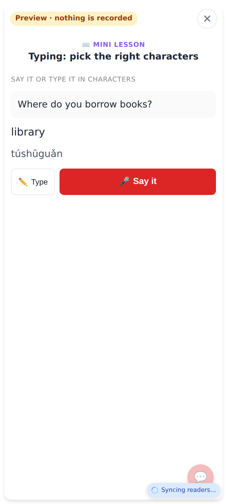
write_typed opens on 🎤 Say it, with ✏️ Type beside it and no keyboard.

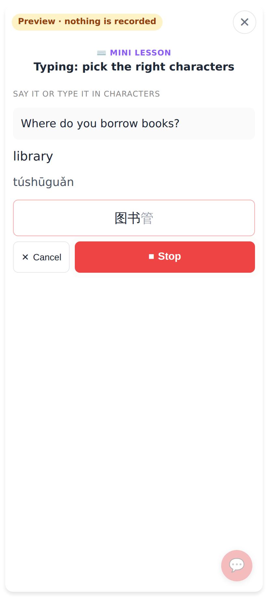
Listening: the words stream in (图书 confirmed, 管 still provisional).

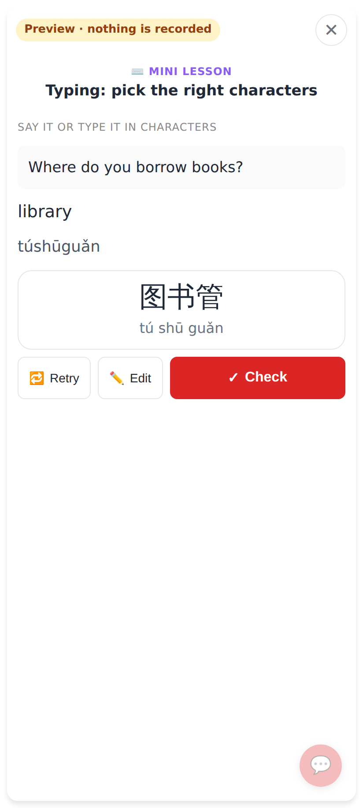
Review: what was heard, then 🔁 Retry · ✏️ Edit · ✓ Check.

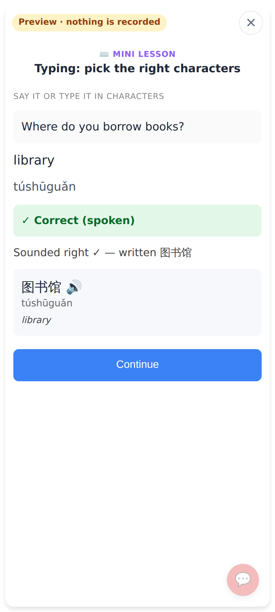
The recogniser wrote 图书管. That answer is unchanged, and it is right by sound: "✓ Correct (spoken)", "Sounded right ✓ — written 图书馆".

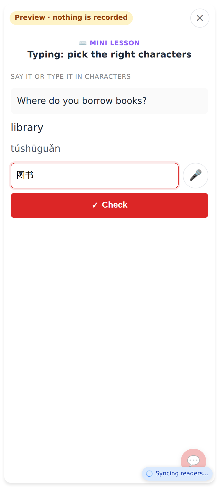
✏️ Type: the box with a 🎤 to go back to speaking.

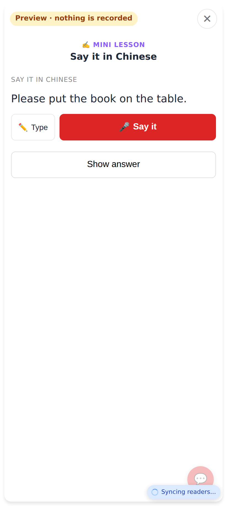
Translate: Say it / Type, plus a quiet "Show answer" for answering in your head.

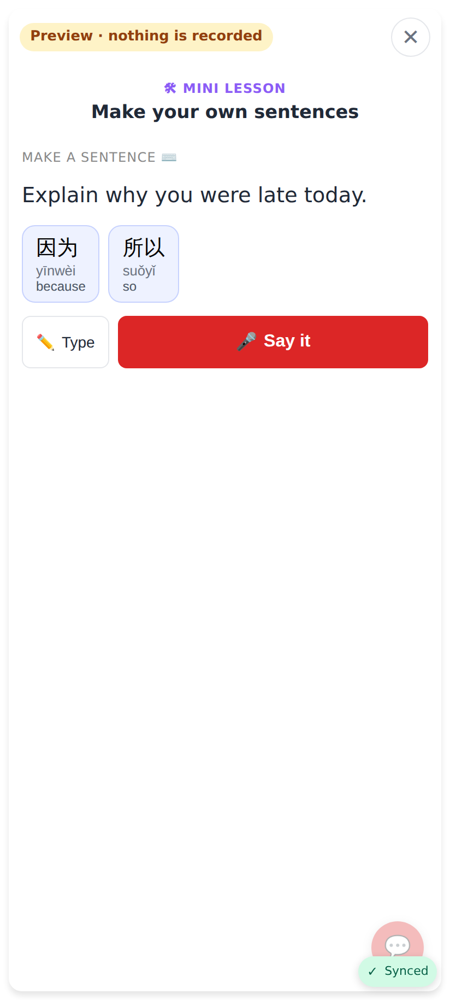
Sentence making: what was said goes to Claude's sentence check.

## Lab

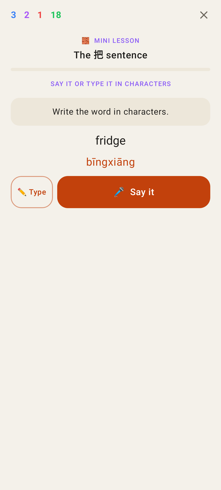
write_typed, voice first.

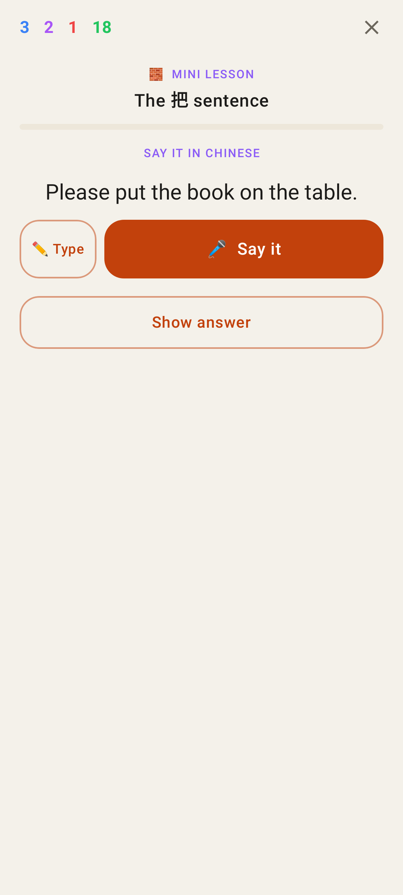
Translate, with Show answer.

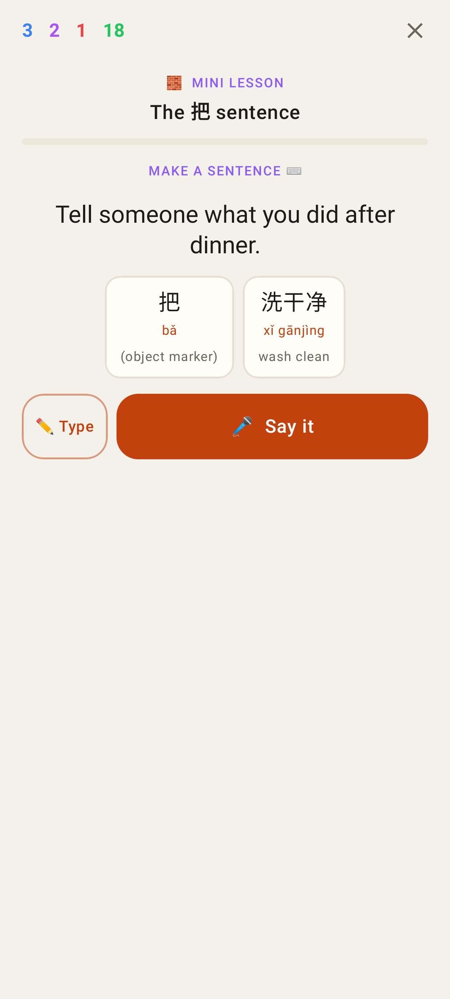
Sentence making.

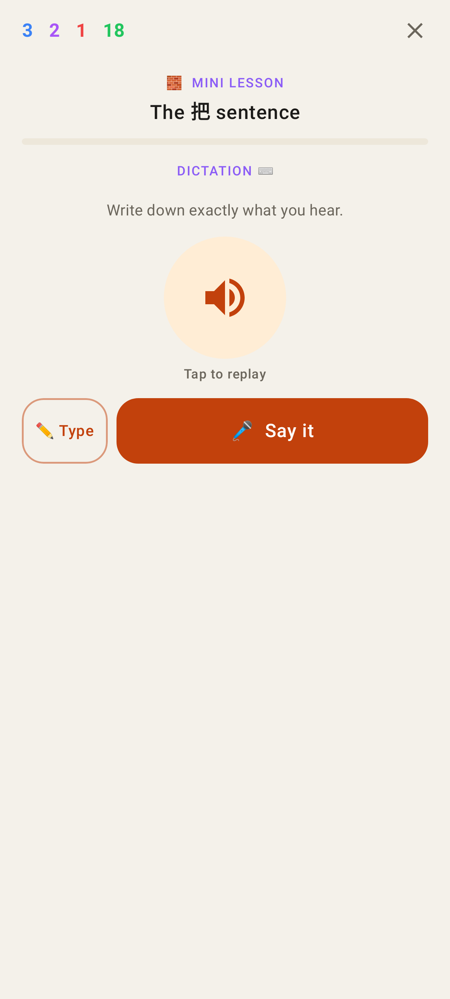
Dictation (typed input).

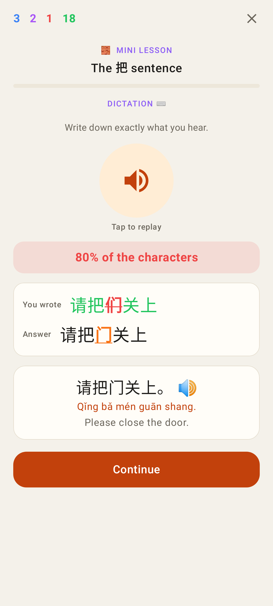
A typed dictation answer, checked strictly as before.
