# 🥽 VR (beta) — `/vr` (docs/VR.md)

Taken from the dev build: the flat preview (what a browser without immersive WebXR shows) at 1280×800 and
at the phone viewport (412×915, 2×), and the immersive session in an emulated Meta Quest 3 (IWER).

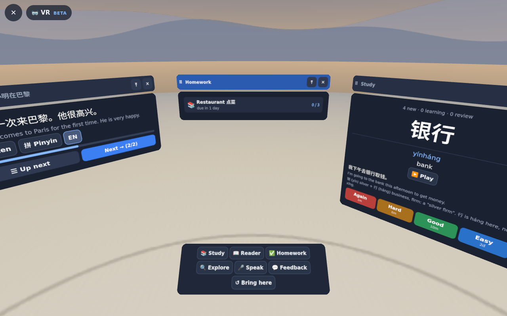
The flat preview on a wide screen: Reader, Homework and Study windows in the ring, the tray (a desk) below.

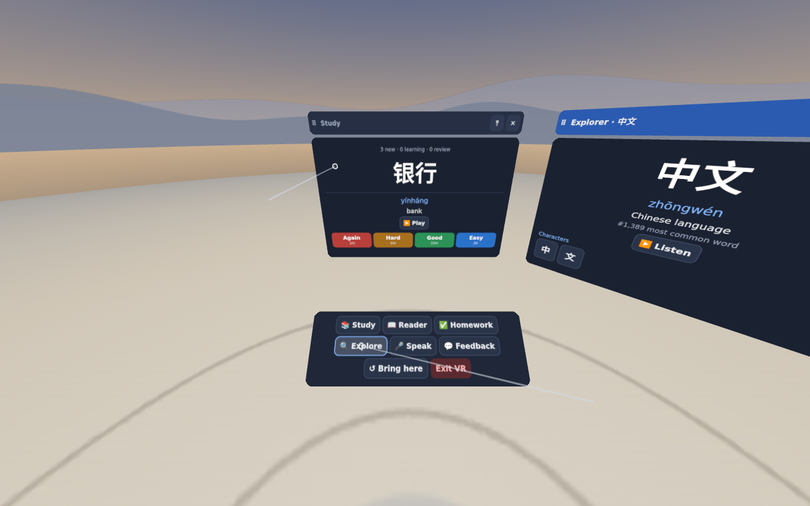
In the headset (emulated Quest 3, one eye): two controller rays, the Study card's answer side, the Explorer window opened from the tray, Exit VR.

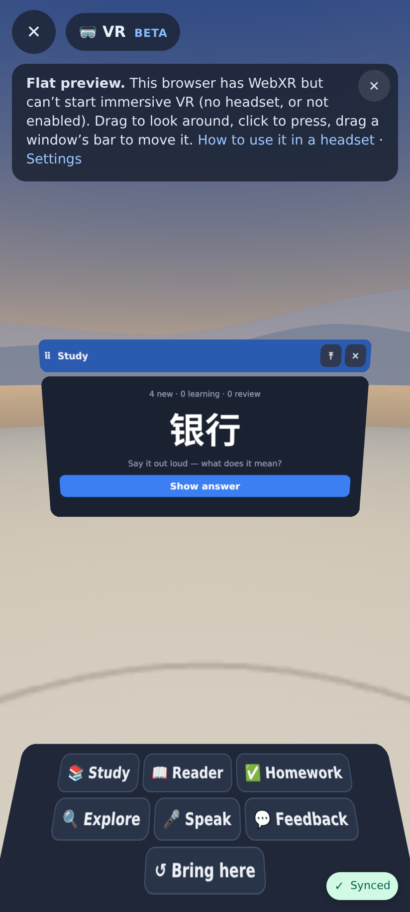
Study: the regular session's next card (the "Flat preview" note, dismissable).

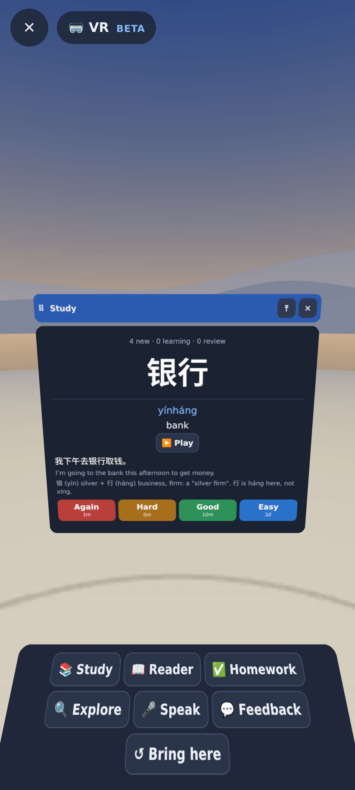
Show answer: pinyin, meaning, the card sentence (every word tappable), Again / Hard / Good / Easy with intervals.

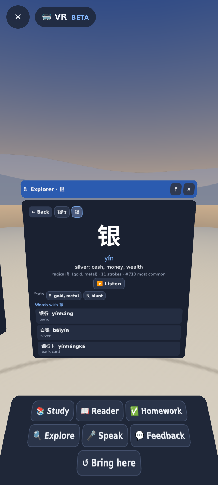
Tapped 银行 on the card, then 银: the Explorer window (readings, parts, words with 银, ← back and the trail).

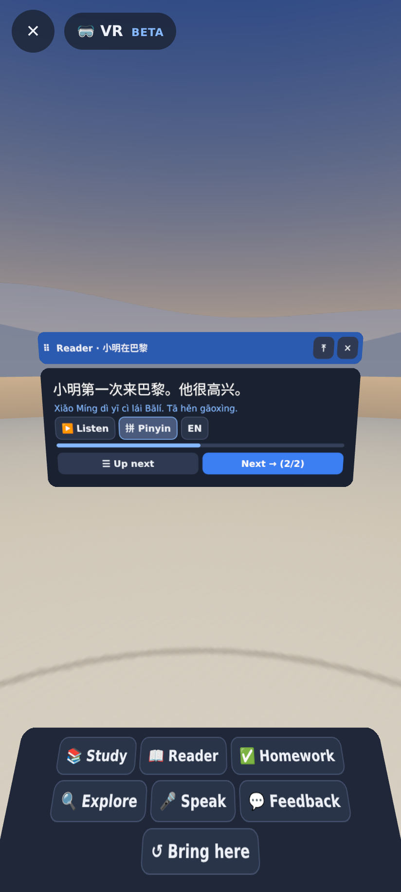
Reader: a story page with 拼 Pinyin shown, ▶ Listen, Up next / Next.

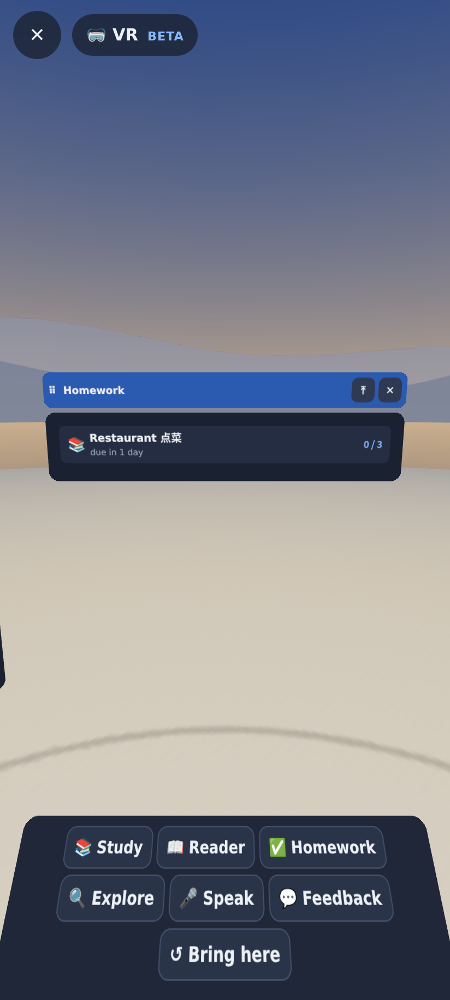
Homework: the one-off homework list (a word list from the tutor, due in 1 day).

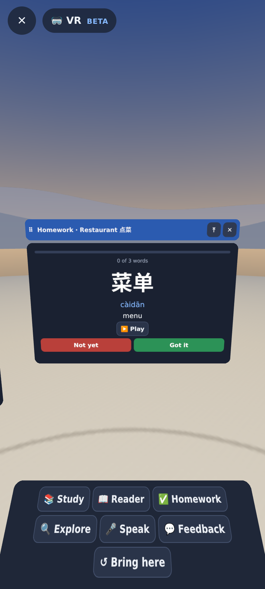
The word list passed in VR: Show answer → Not yet / Got it.

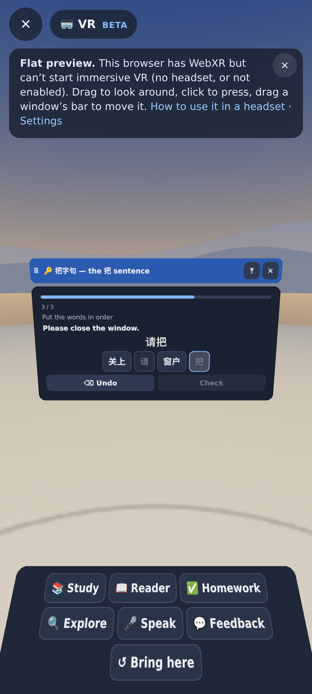
A mini lesson played from its spec (content as data): the scramble exercise, tiles tapped in order.

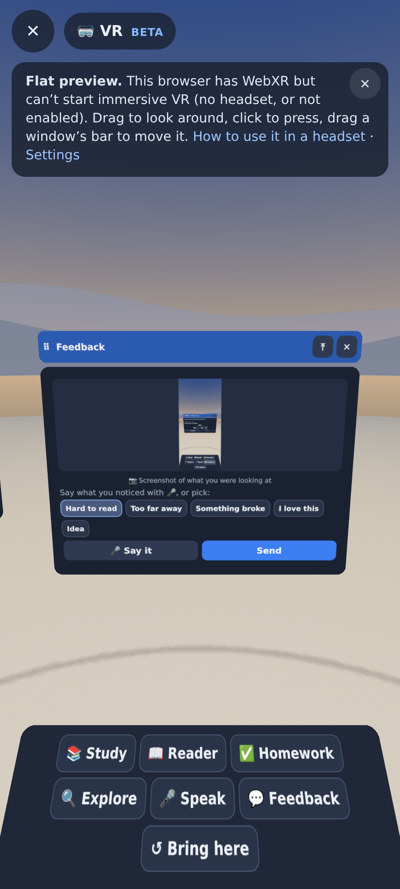
💬 Feedback: the screenshot of the view, quick chips, 🎤 Say it, Send.

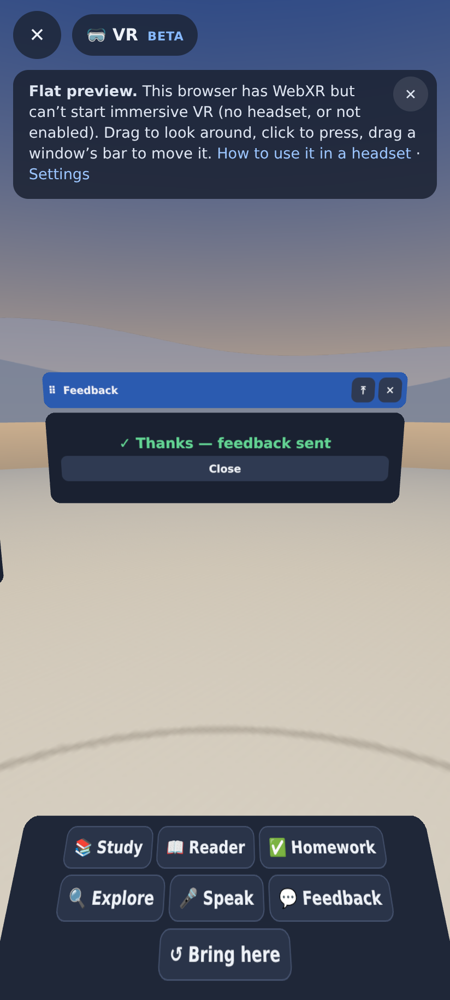
Sent through POST /api/feedback.
