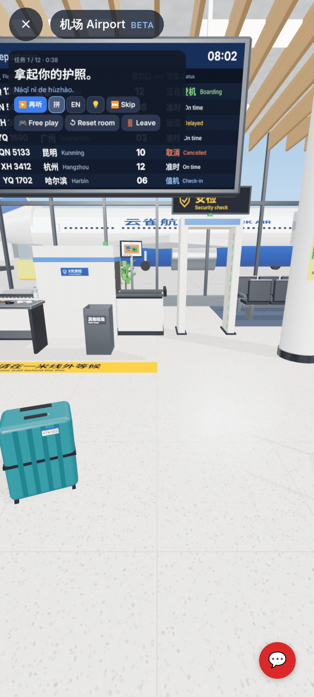
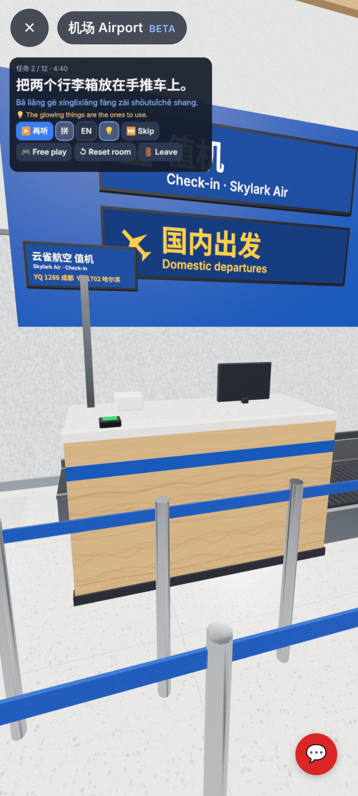
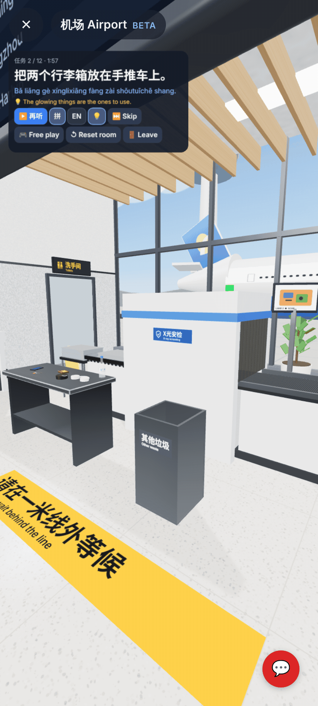
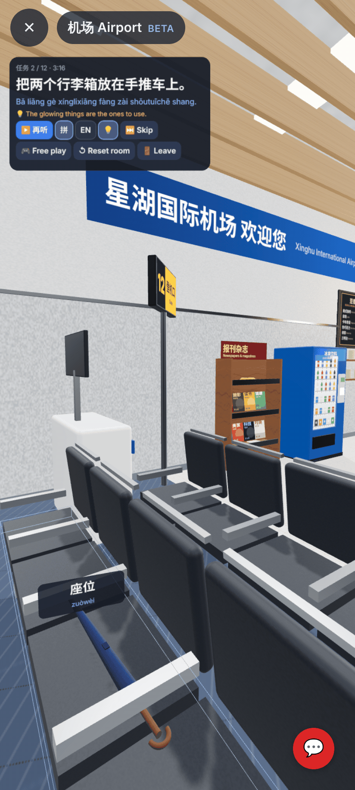
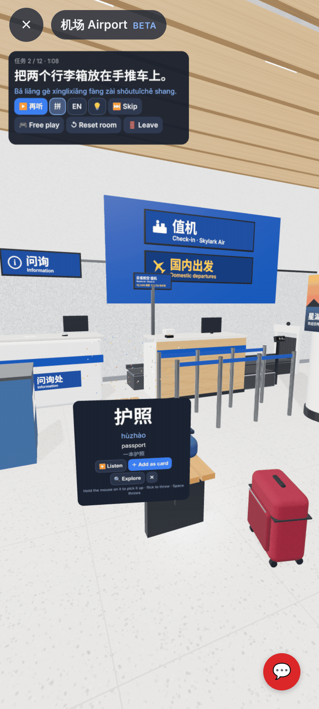
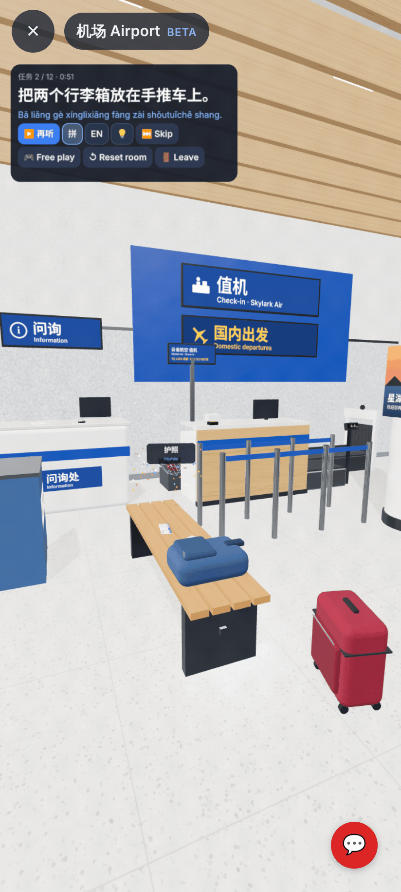
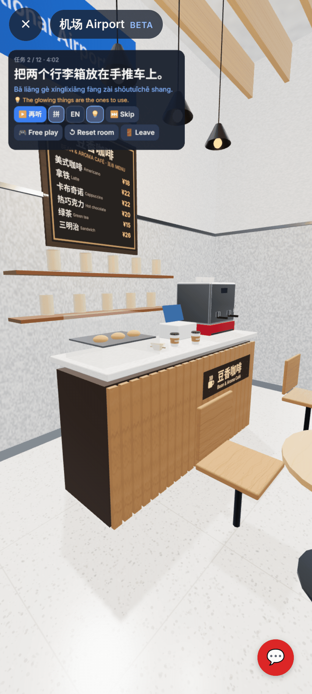
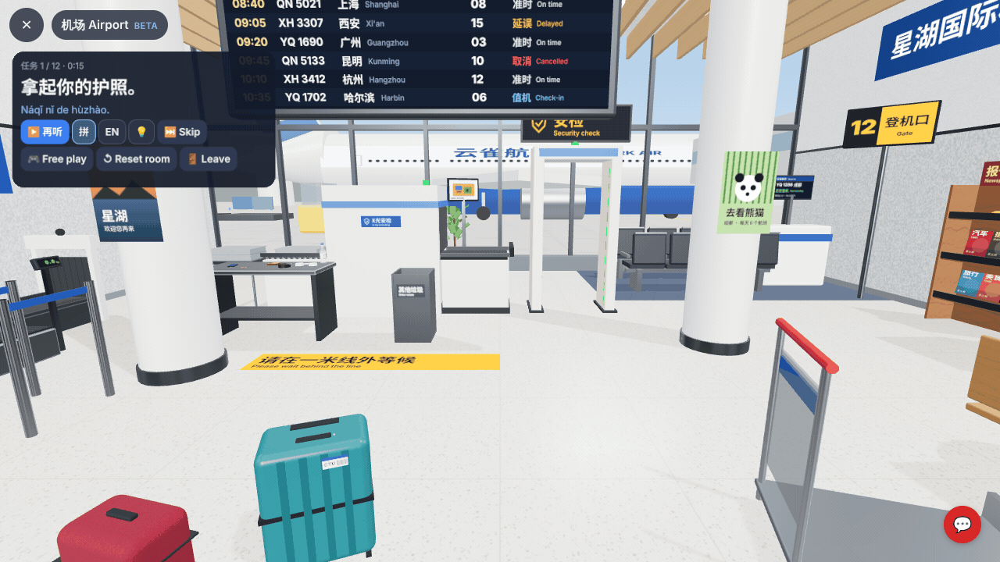

# 🥽 VR world: 机场 Airport — screenshots

Flat preview (headless Chromium, SwiftShader). Phone shots at 412×915 @2x, one wide at 1280×720.

Start view by the exit doors: the departures board (显示屏) hanging over the hall, security (安检机, 安检门, the bin, the one-metre line), the 云雀航空 plane through the glass, the suitcases and the trolley.

Check-in: the counter (柜台) with the bag-tag printer and staff screen, the queue lane, the 值机 / 国内出发 backdrop, the conveyor belt (传送带) running to its rubber-curtain portal.

Security: the divest table with phone, keys, wallet, belt, headphones and the water bottle; grey trays (托盘) on the roller table; the x-ray machine (安检机) with its scan monitor; the bin for the water (不能带水！).

Gate 12 (登机口): two rows of beam seats (座位) on the carpet with a forgotten umbrella (雨伞), the gate desk's boarding screen, the newsstand (报刊架) and the vending machine (自动售货机).

Inspecting the passport: 护照 · hùzhào · passport · 一本护照, ▶ Listen, ＋ Add as card, 🔍 Explore.

Task 1 (拿起你的护照。) done by holding the mouse on the passport: sparkles at it, task 2 (把两个行李箱放在手推车上。) is up.

The café (豆香咖啡): the bar (吧台) with an espresso machine (咖啡机), two coffees and a sandwich, the menu board with prices, pendant lamps.

The start view at 1280×720 with the task panel.
