# 🥽 VR world: 家 Apartment — screenshots

Flat preview (headless Chromium, swiftshader). Phone shots at 412×915 @2x, wide at 1280×720.

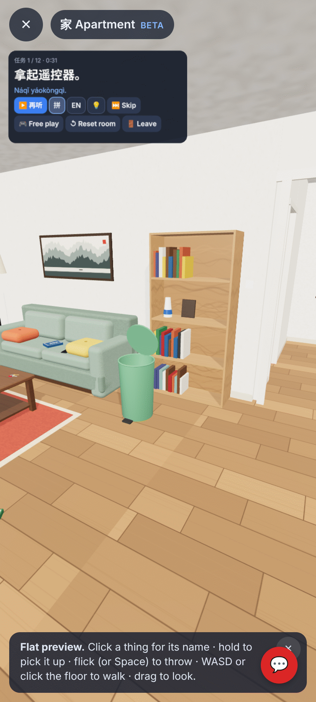
Start view on a phone: the living room (sofa, coffee table, bookshelf, 山水 painting) and the hallway with 家和万事兴.

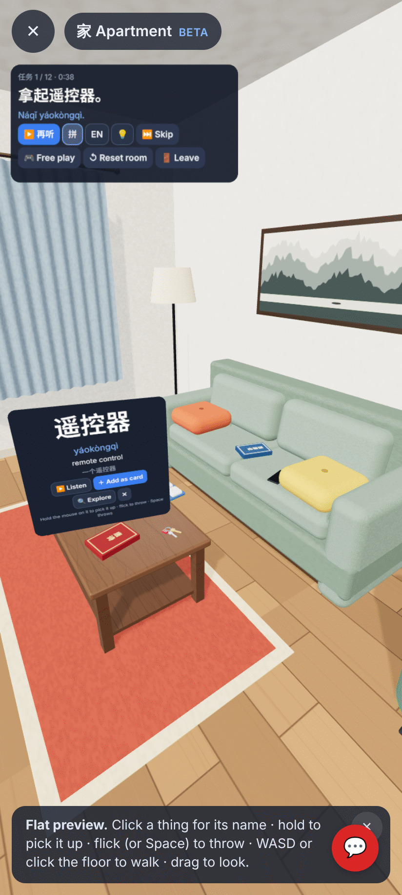
Click the remote: 遥控器 · yáokòngqì · remote control · 一个遥控器, ▶ Listen, ＋ Add as card.

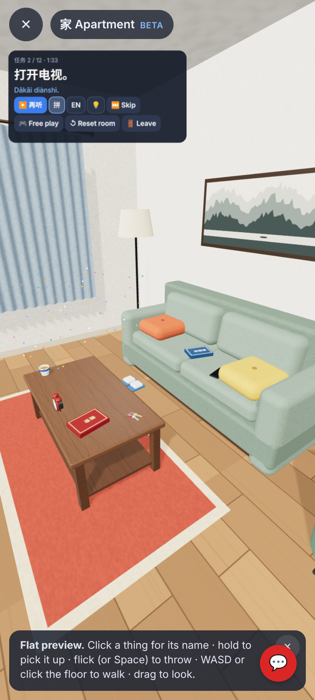
Task 1 (拿起遥控器) done — sparkles, and the next task: 打开电视。

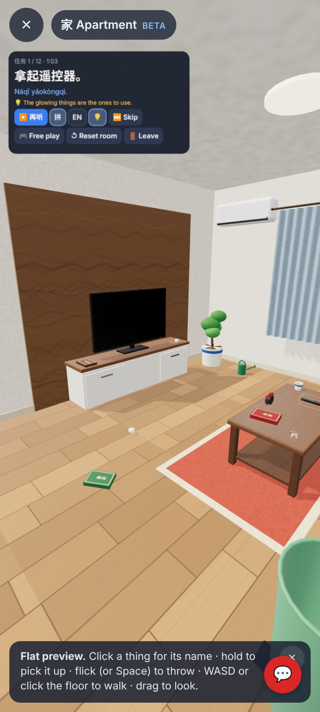
The TV wall (walnut panel), the window behind curtains, the air conditioner, a money tree and its watering can.

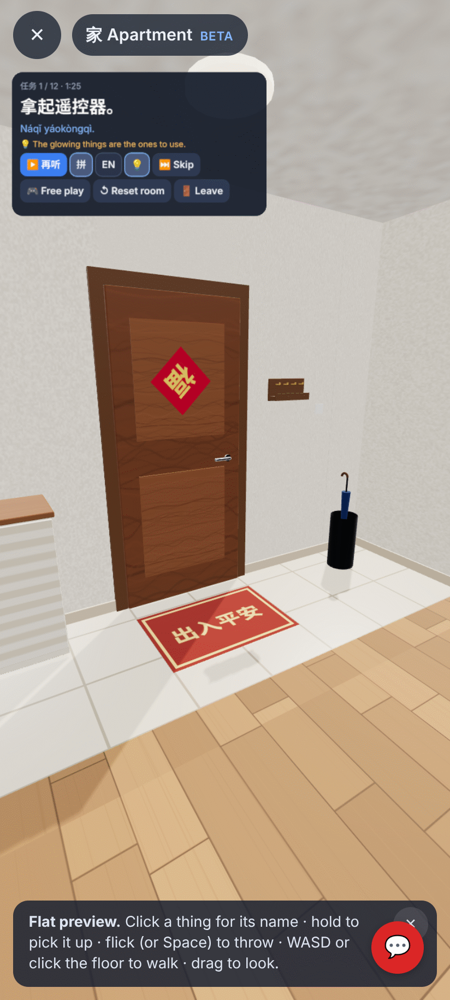
The entry (玄关): the front door with 福 upside down, the 出入平安 doormat, the key hooks, the umbrella stand, the shoe cabinet.

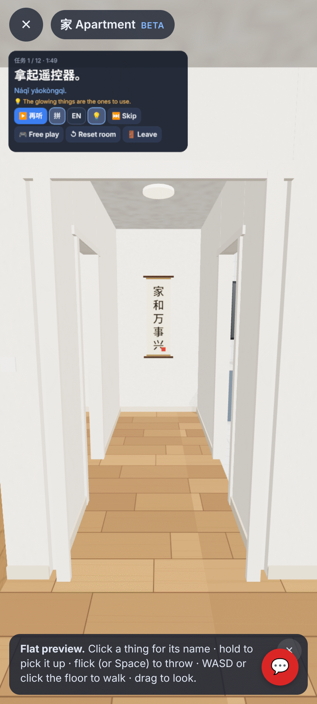
The hallway, from the living room: the calendar (二〇二六年 十一月) on the right.

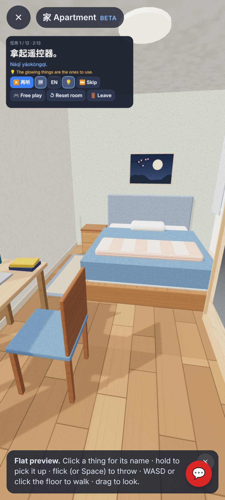
The bedroom: bed with pillow and quilt, bedside table, a moon picture, desk + chair.

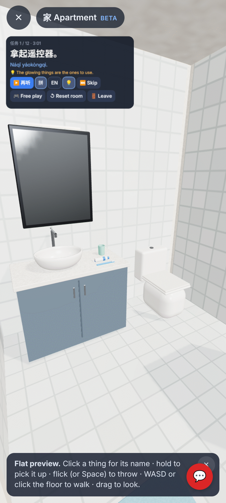
The bathroom: washbasin on a vanity, tap, mirror, toothbrush / toothpaste / cup, toilet.

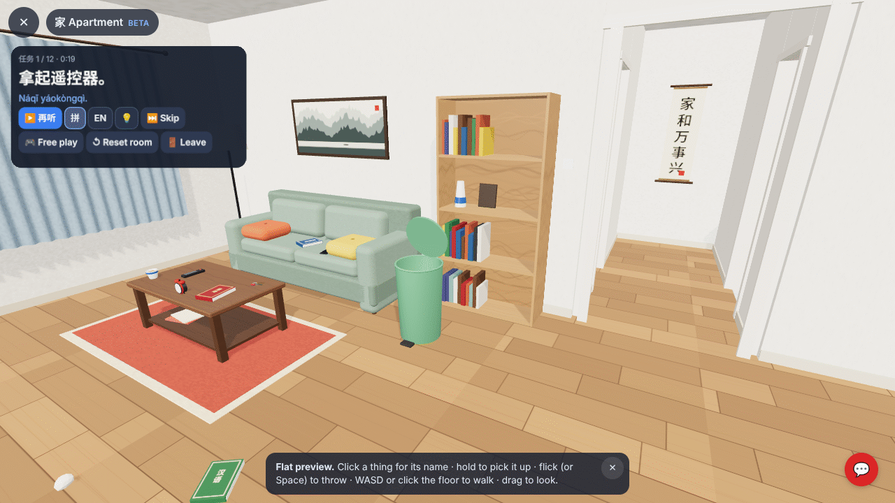
The start view at 1280×720 (the thumbnail is this view without the HUD).

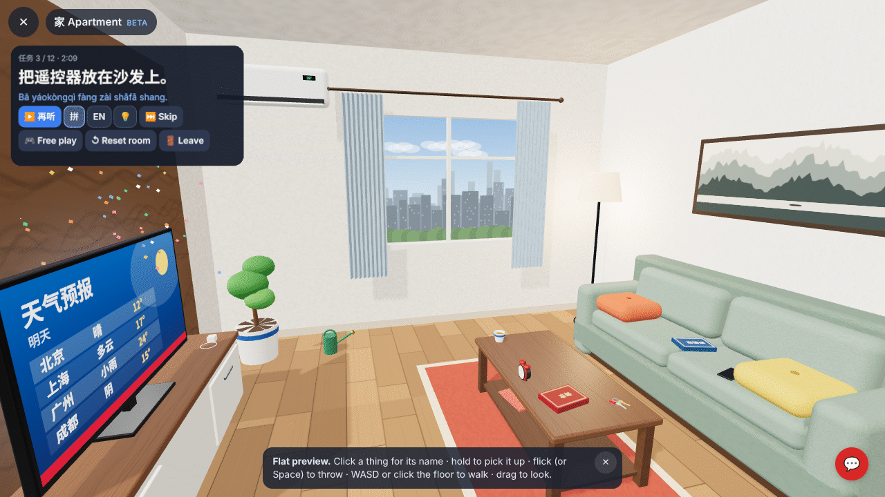
States: the TV on (天气预报 — 北京 晴 12° …), the curtains drawn open onto the city, the AC and the floor lamp on.

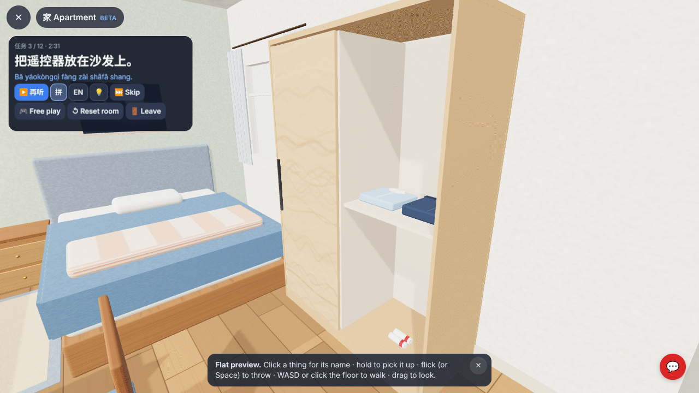
The wardrobe's sliding door open: the shirt and trousers on the shelf, socks below.

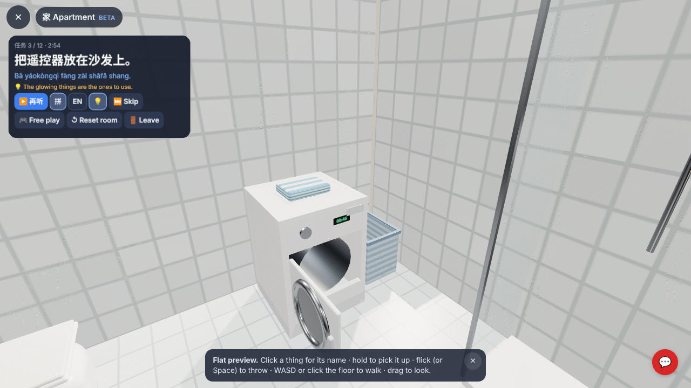
The washing machine's door open, the laundry basket beside it, the towel on top.
