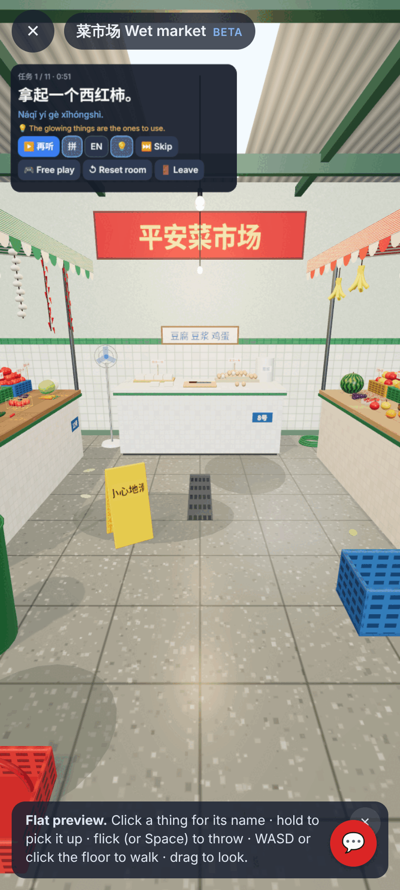
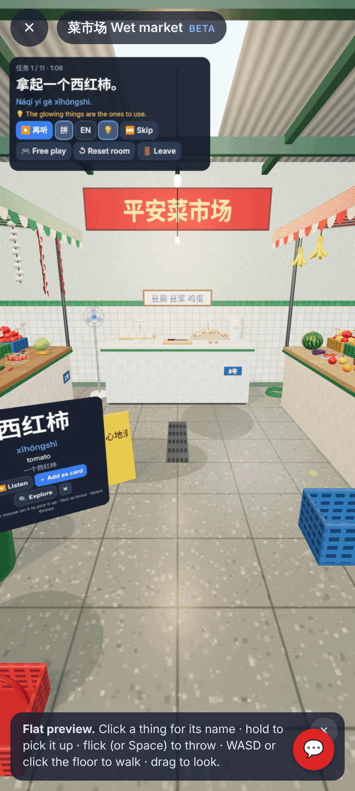
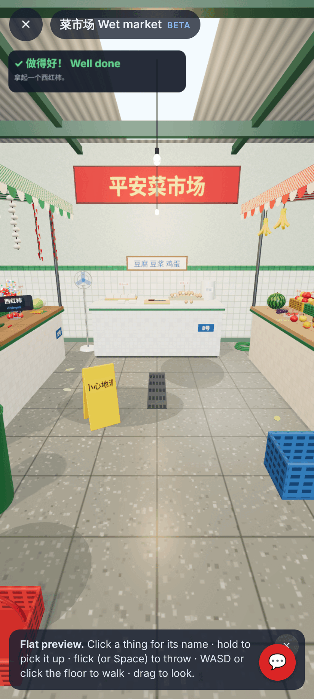
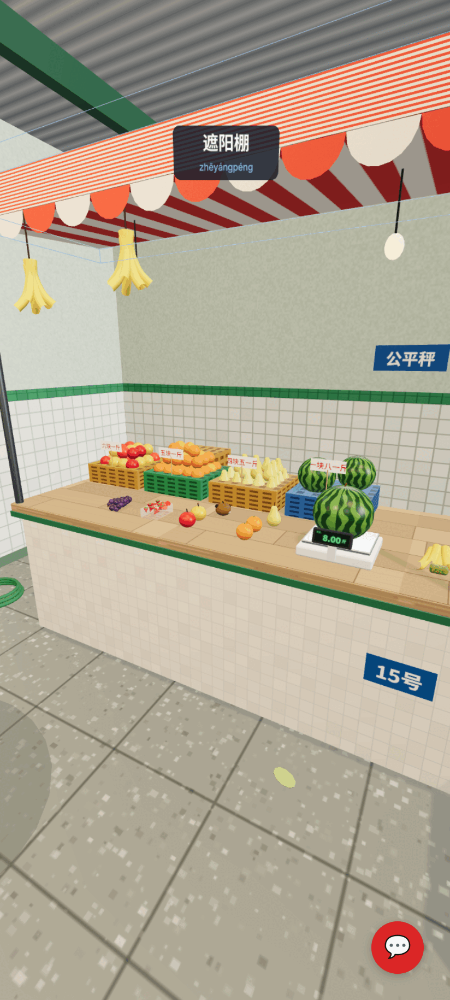
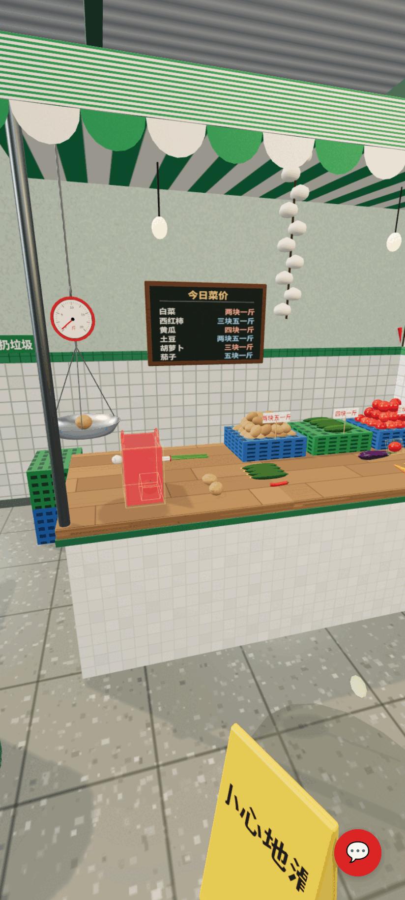
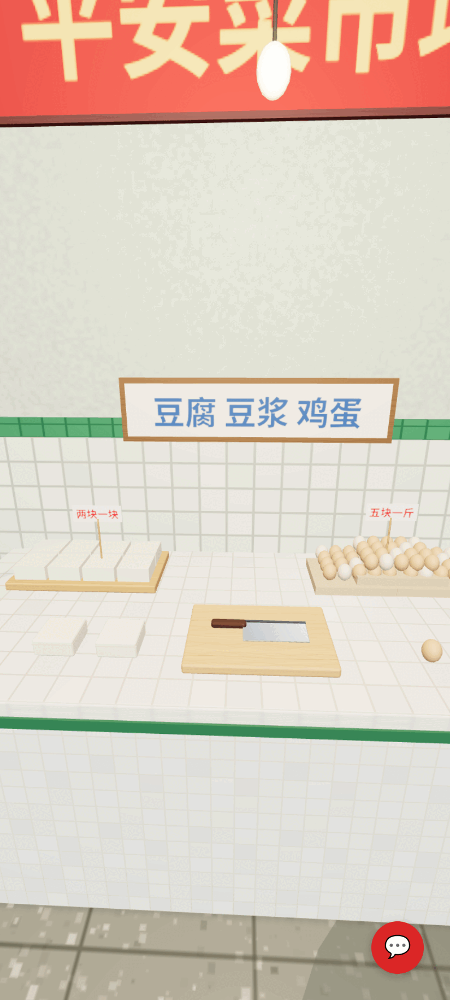
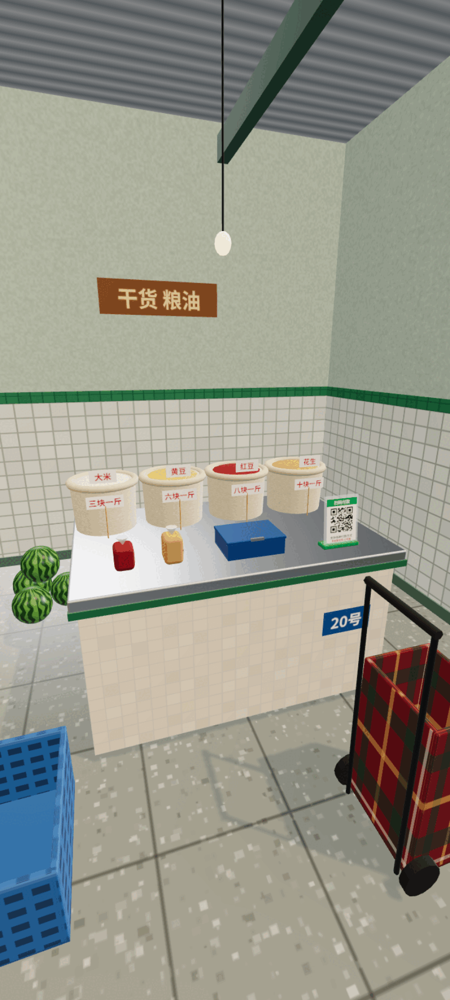
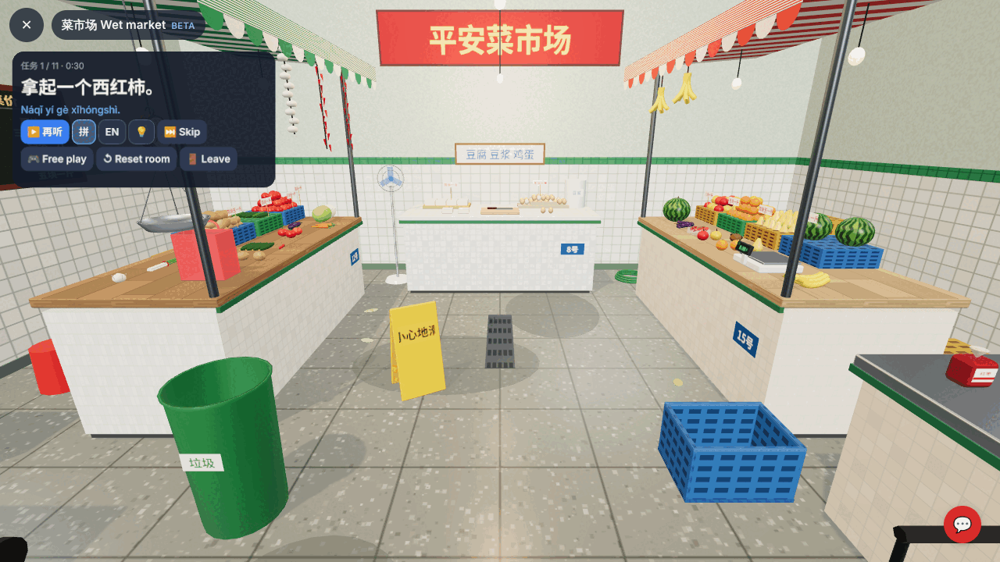

# 🥬 VR world 菜市场 Wet market — screenshots

Flat preview (headless Chromium, software WebGL), phone viewport 412×915 @2x unless noted.

The start view down the aisle: 菜摊 left, 水果摊 right, 豆腐摊 at the far end, 平安菜市场 over it; task 1 拿起一个西红柿。

Clicking a tomato: 西红柿 · xīhóngshì · tomato · 一个西红柿, ▶ Listen, ＋ Add as card, Explore.

Holding the mouse on a tomato picks it up: ✓ 做得好！ — the next task is 把西瓜放在电子秤上。

The 水果摊 with the watermelon on the 电子秤 — the LCD reads 8.00 斤 (a 4 kg melon; the scale really weighs what's on it).

The 菜摊: the hanging 秤 with a potato in its pan (the needle swings to the weight), the red 塑料袋 with a tomato in it, the 今日菜价 chalk board, chilli strings and garlic.

The 豆腐摊: tofu on a wet tray (两块一块), eggs by the jin (五块一斤), a 菜刀 on its board, the soy-milk bucket.

The 干货摊: open sacks of 大米 / 黄豆 / 红豆 / 花生 priced by the jin, bags of 花生 and 红枣, the blue 钱箱, the invented 扫码付款 二维码 stand; the tartan 买菜车 and the 筐.

1280×720: the whole hall — the 电风扇, the 垃圾桶, the 筐, the 干货摊 at the right edge.
