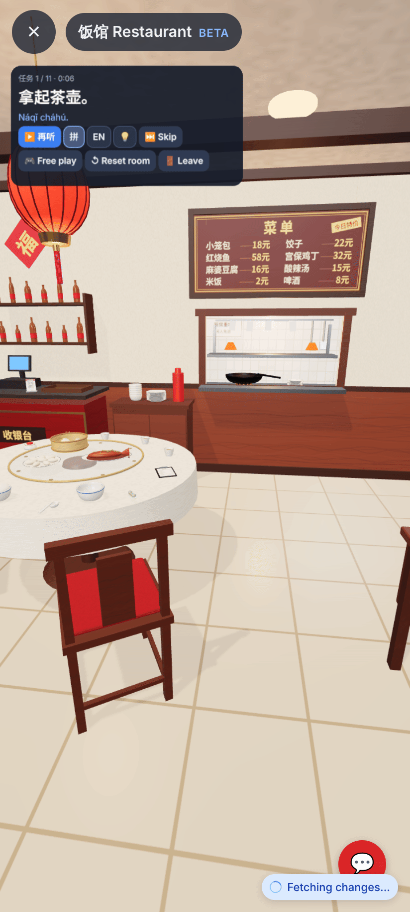
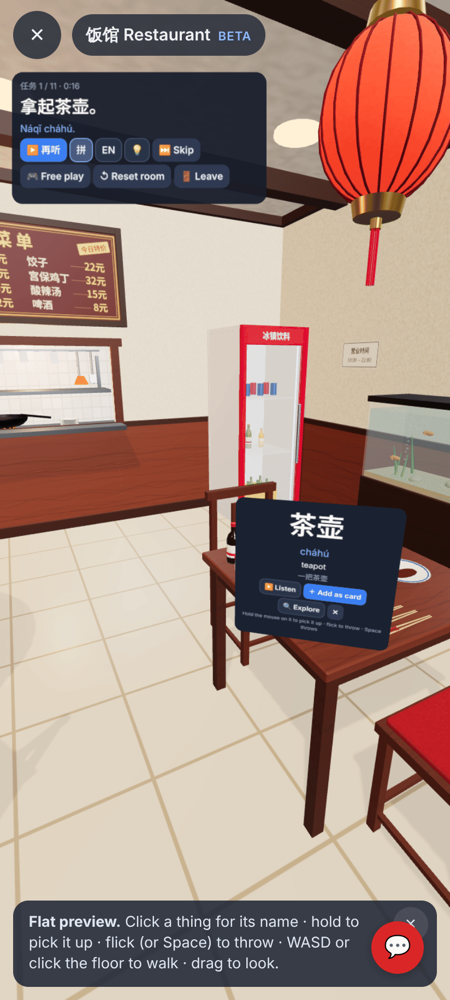
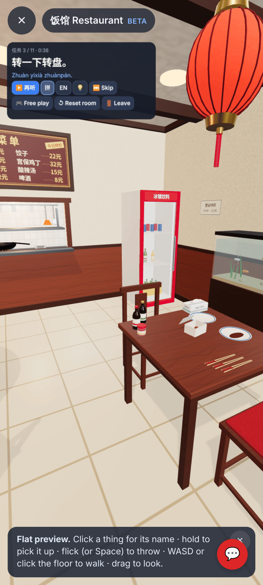
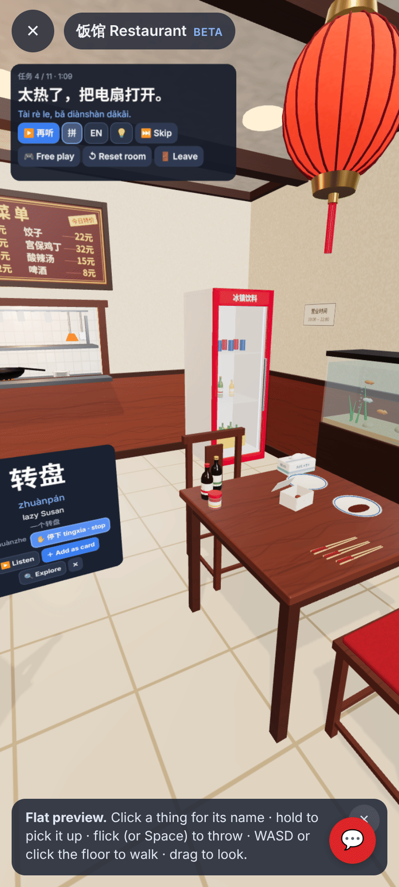
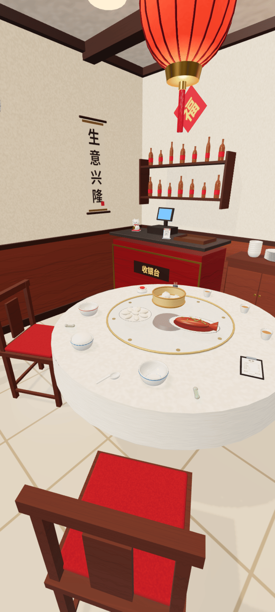
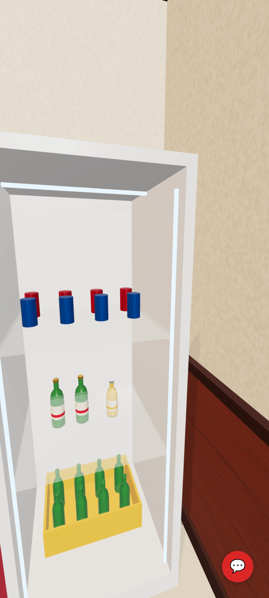
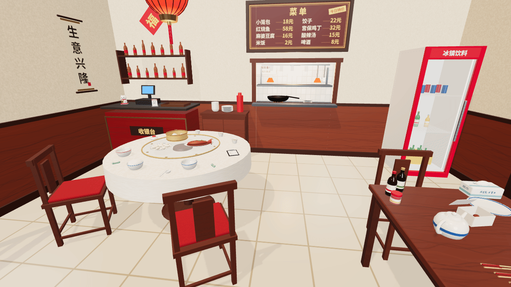
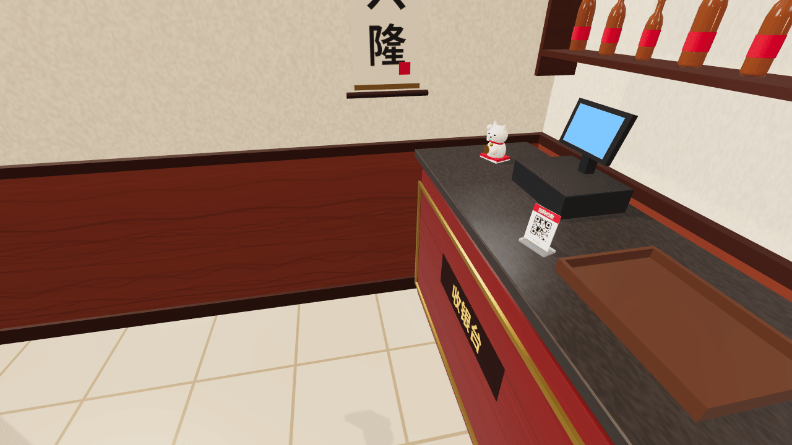

# 🥽 VR world: 饭馆 Restaurant — screenshots

Flat preview (headless Chromium, SwiftShader WebGL). Phone shots at 412×915 @2x, wide at 1280×720.

At the spawn point: the till, the serving hatch under the menu board (the kitchen glows behind it), the round table with its lazy Susan; task 1 拿起茶壶。

Clicking the teapot: 茶壶 · cháhú · teapot · 一把茶壶, ▶ Listen, ＋ Add as card, 🔍 Explore.

After 拿起茶壶 and 把茶壶放在转盘上 (the teapot is now on the lazy Susan): task 3 转一下转盘。

The lazy Susan's panel after ✋ 转 zhuàn: it is turning, the verb is now 停下 tíngxia · stop; task 4 太热了，把电扇打开。

Close-up: 红烧鱼, a plate of 饺子 and a 蒸笼 of 包子 on the lazy Susan; bowls, teacups, chopstick rests, the bill and the call button round the edge; the red lantern; the till with 招财猫 and the liquor shelf behind.

The glass-door fridge (冰镇饮料) opened from its panel: 啤酒 ×2 and 汽水 on the lower shelf, cans and a crate of bottles.

1280×720 at the spawn point (also the picker thumbnail, scaled to 640×360).

The till: 招财猫 with its waving paw, the 扫码付款 QR stand, the register, the waiter's tray.
