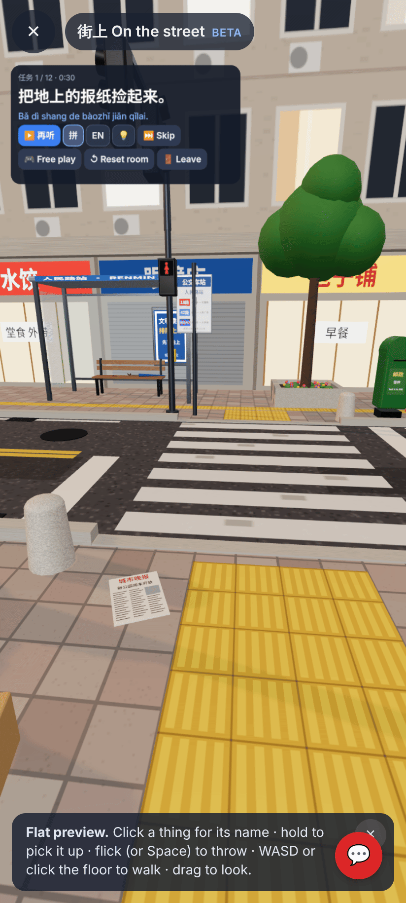
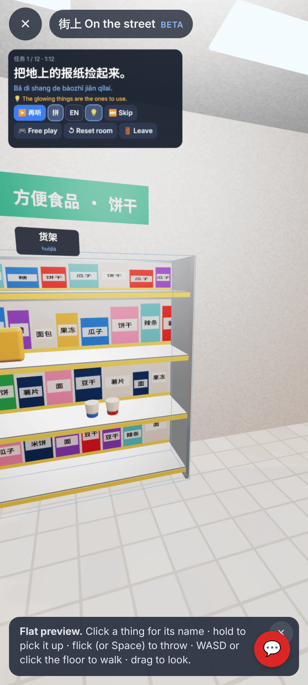
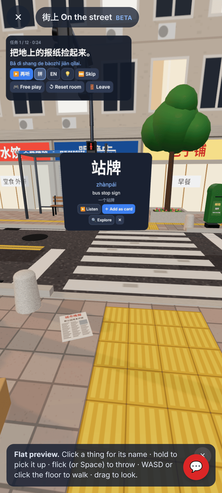
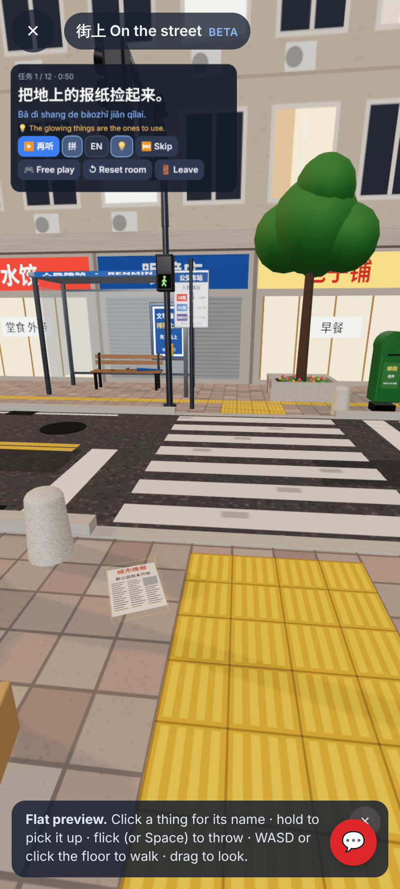
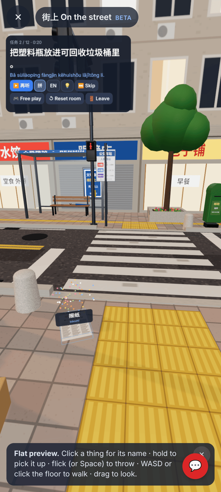
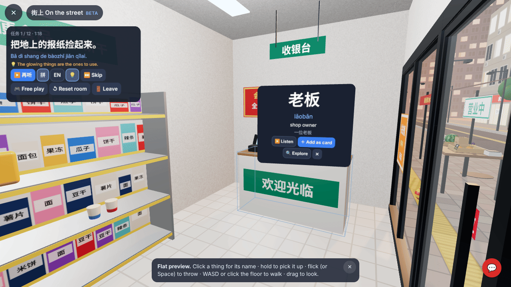
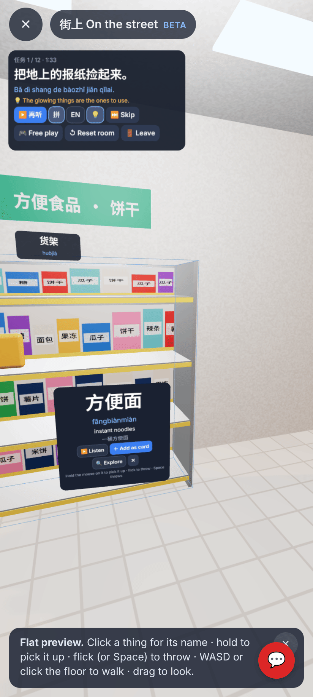
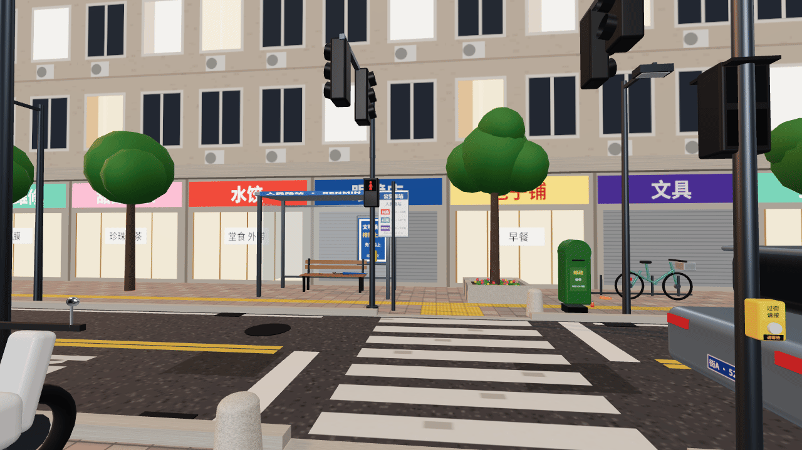

# 🥽 VR world: 街上 On the street

Flat preview (headless Chromium + SwiftShader), phone shots at 412×915 @2x, wide shots at 1280×720.

Where you start: this side's pavement facing the crossing — the 公交车站 (shelter, 长椅, 站牌) across the road, the 邮筒, a 树 in its 花坛, the 共享单车; the first task 把地上的报纸捡起来。

Inside 街角便利店 (invented): the 货架 of snacks along the back wall, with grabbable instant noodles, crisps and biscuits.

Inspecting a thing: 站牌 / zhànpái / bus stop sign / 一个站牌, ▶ Listen, + Add as card.

After 按一下过马路的按钮 the walkers' signal turns green (and beeps) on both sides of the road.

Task 1 done (sparkles over the newspaper) — the next task, 把塑料瓶放进可回收垃圾桶里。

Wide: the 柜台 with the till, a 关东煮 pot and the scan-to-pay stand, the 老板 behind it (inspected), the shelves, the glass front and the street outside.

方便面 / fāngbiànmiàn / instant noodles / 一桶方便面.

The picker's thumbnail view: shopfronts across the road, flats with lit windows and air-conditioners, the signal heads, the 汽车 and the crossing button on the right.
