# 🥽 VR worlds — screenshots (flat preview, headless Chromium + SwiftShader)

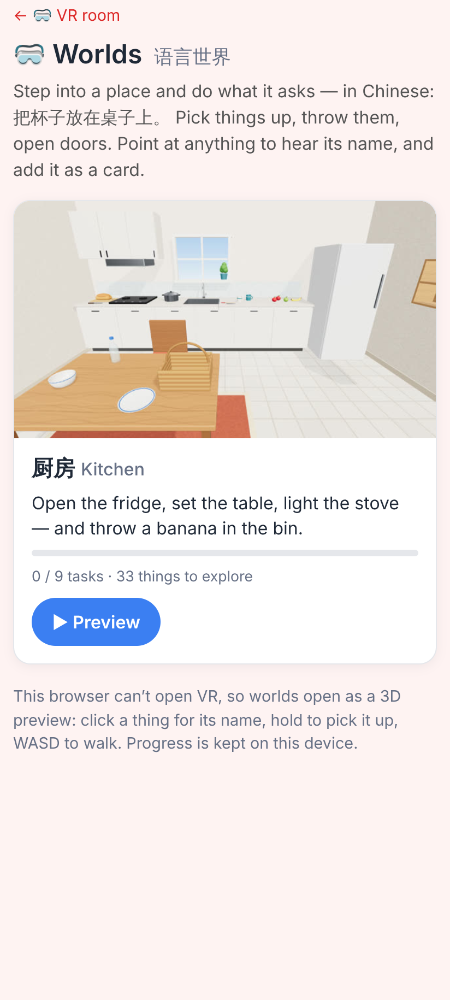
The picker `/vr/worlds` on a phone (412×915 @2x): the kitchen's card, progress, Preview (Enter VR appears in a WebXR browser).

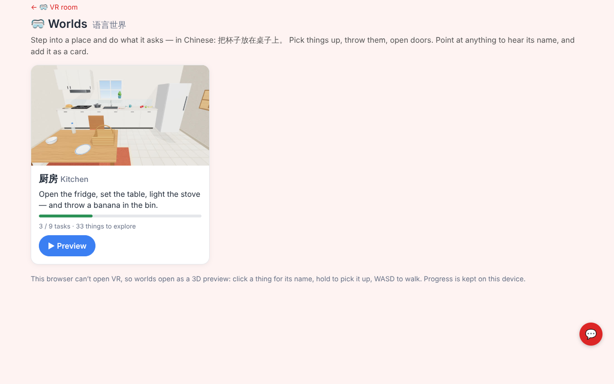
The picker on a wide screen after three tasks: 3 / 9.

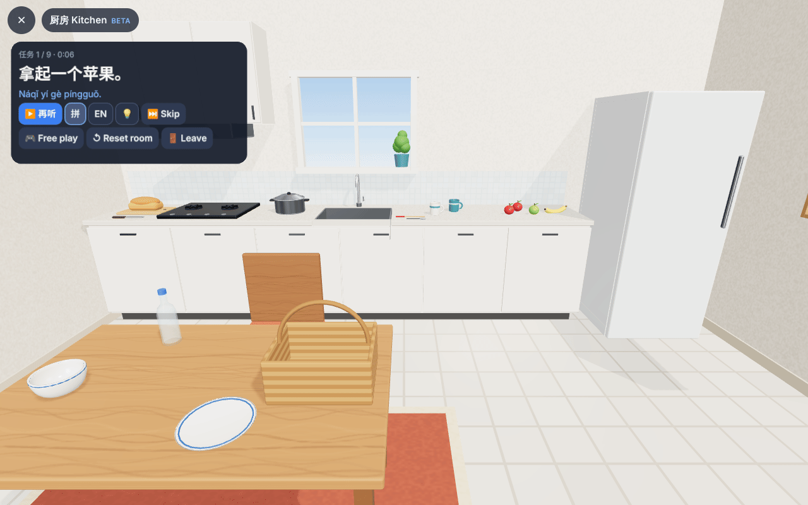
厨房 — where you start: the task panel (拿起一个苹果。 + pinyin, ▶ 再听, 拼 / EN, 💡, Skip, Free play, Reset room, Leave).

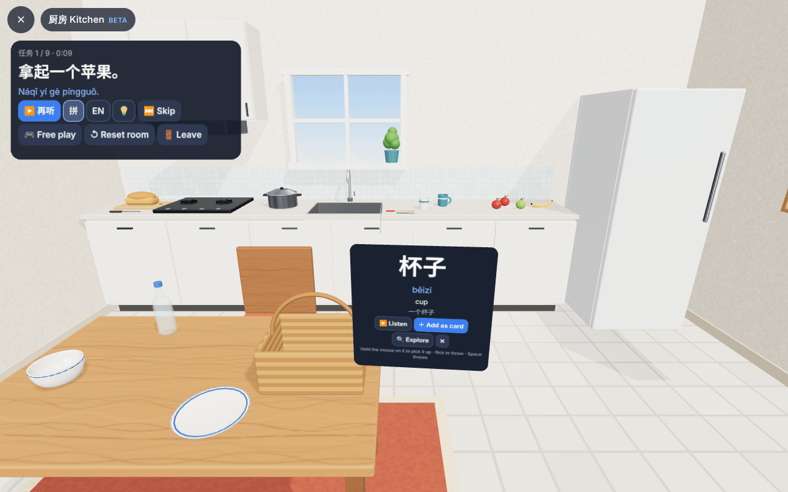
Click the cup: 杯子 / bēizi / cup / 一个杯子, ▶ Listen, ＋ Add as card (into "From VR"), 🔍 Explore.

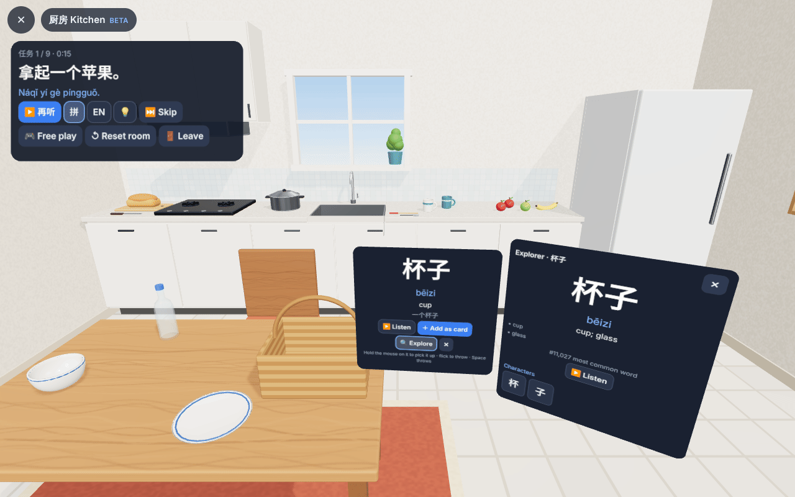
🔍 Explore opens the /vr room's explorer window beside the panel.

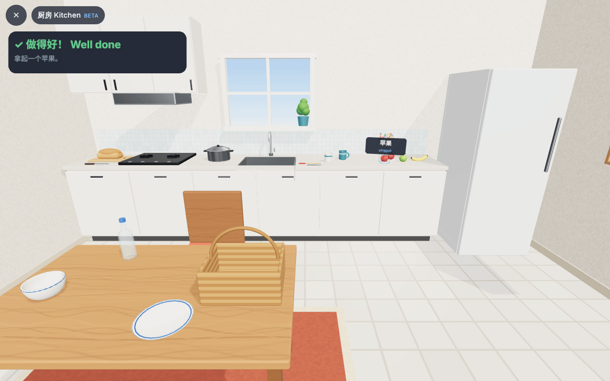
Holding the mouse on an apple picks it up: task 1 done — ✓ 做得好！ and sparkles (and a chime).

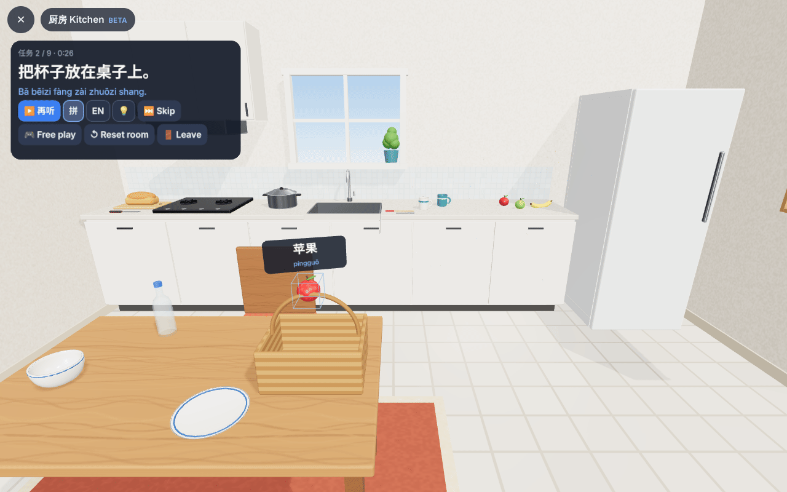
Carrying the apple over the table (it rides over whatever the pointer is on; the outline marks what you hold).

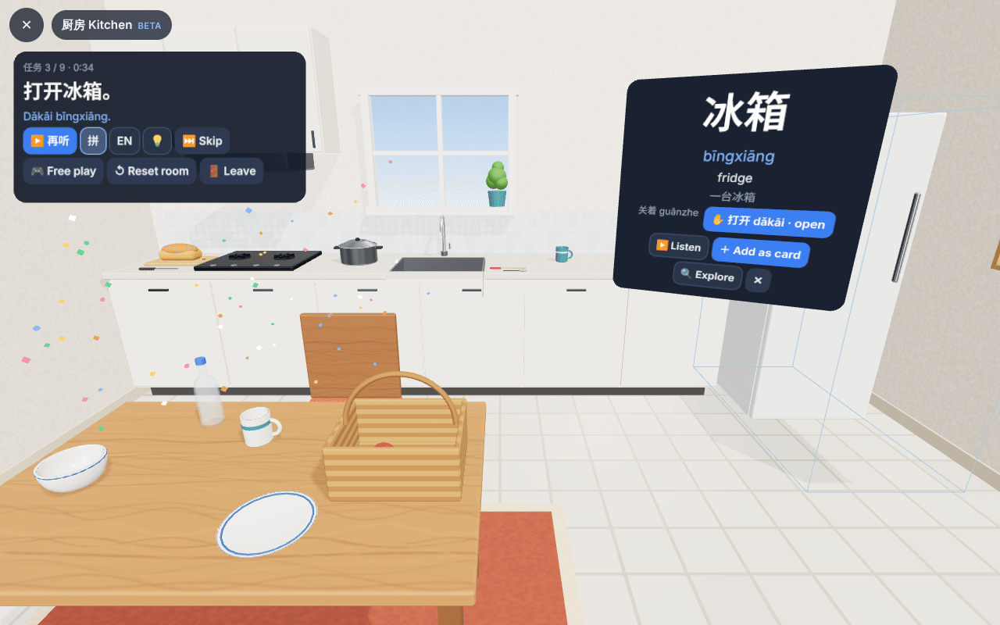
Task 3, 打开冰箱: the fridge's panel has its state and the verb — 关着 guānzhe · ✋ 打开 dǎkāi · open (the cup is on the table, the apple in the basket).

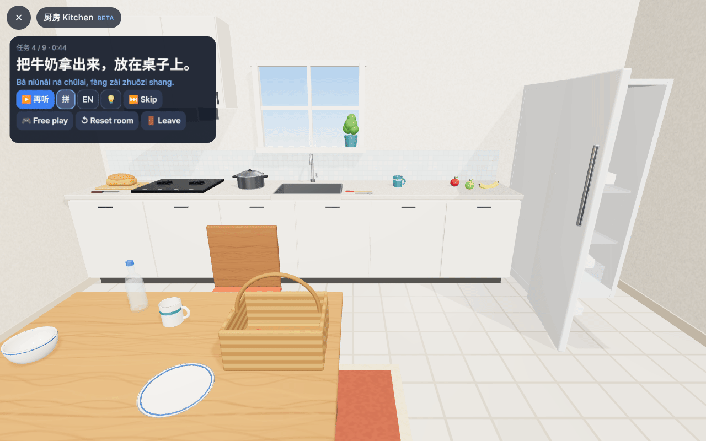
The fridge door swung open (its collider moves with it), the pendant lamp turned on; task 4 is 把牛奶拿出来，放在桌子上。

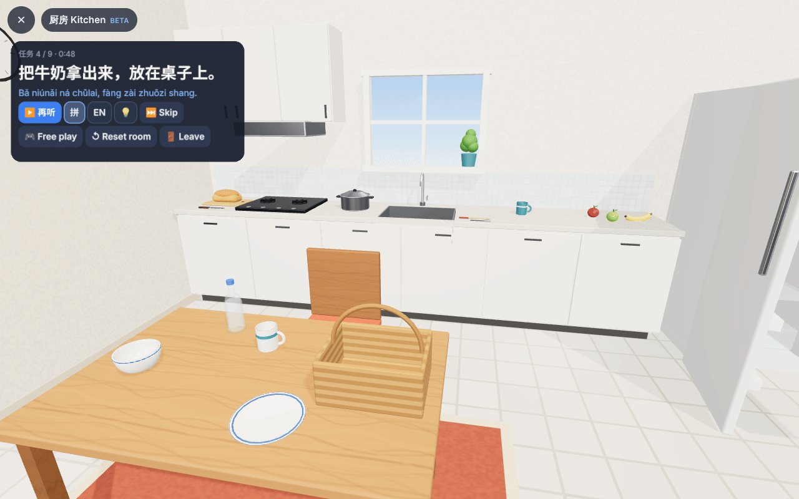
Walked forward (WASD) and turned (Q): the table, the hob, the cooker hood.

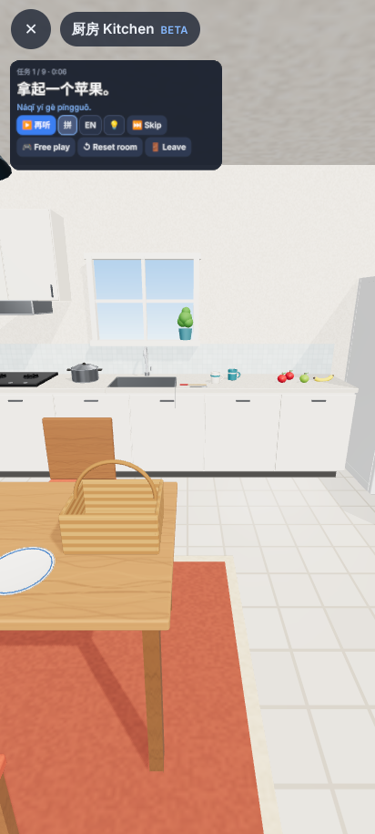
The world on a phone held upright (the walk pad shows on touch screens).
