# 📺 Watch — screenshots

Phone shots at 412 × 915 (2×), web app on the dev server with the **stand-in player** (a drawn colour
clip with a clock, `components/watch/standInPlayer.ts`) — no YouTube frame or thumbnail is in these
pictures (thumbnails are self-made placeholders). The transcript is the E2E stand-in (a self-written
family-dinner dialogue), with hand-written English in place of the stand-in translator's
"Segment N" lines.

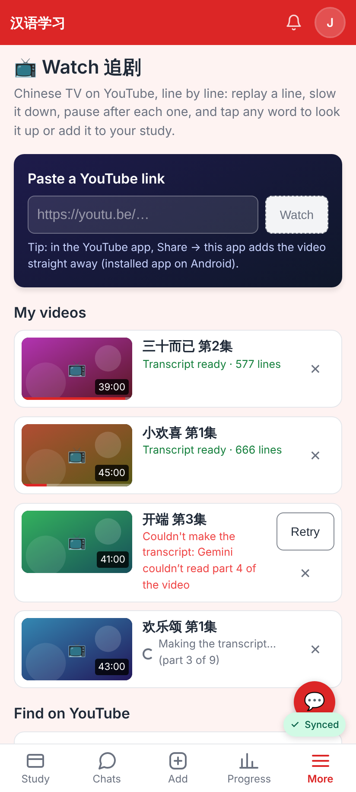
My videos: thumbnail, length, how far I got, and each transcript's status (ready / failed with Retry / being made).

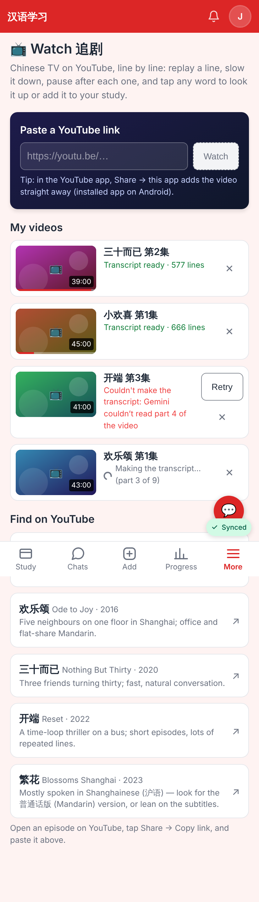
The whole list with **Find on YouTube** for the five shows — 小欢喜 first; 繁花's note says it is mostly Shanghainese.

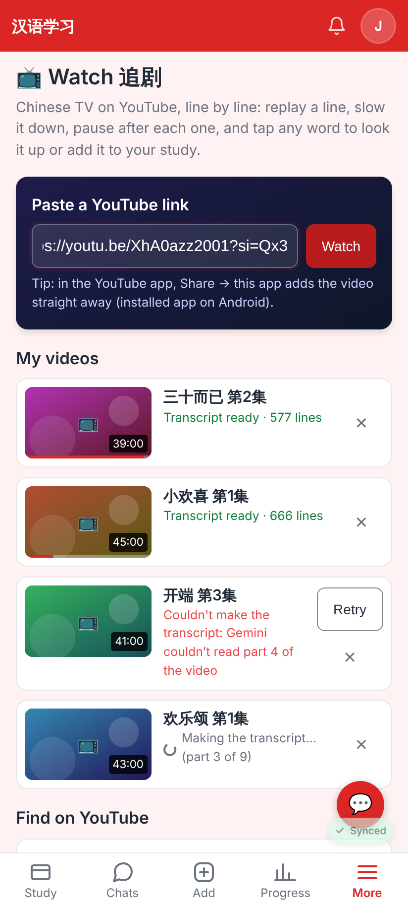
Pasting a YouTube share link (youtu.be/…?si=…) → Watch opens the player.

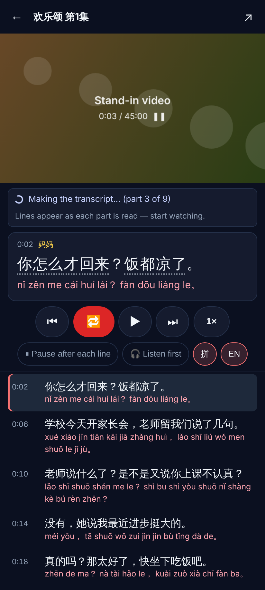
While Gemini reads the video part by part: the video plays as usual, "Making the transcript… (part 3 of 9)", and the lines read so far are already usable.

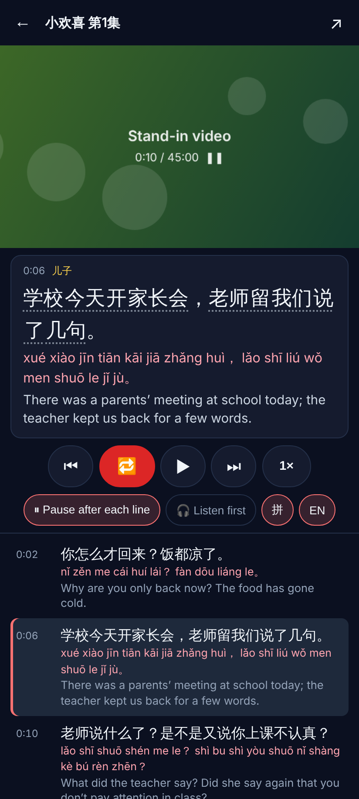
The player: the video on top (nothing over it), the line card (word chips, pinyin, English, speaker), ⏮ 🔁 ▶ ⏭ and the speed chip, the switches, and the transcript with the current line highlighted. "Pause after each line" is on: the line played to its end and stopped there.

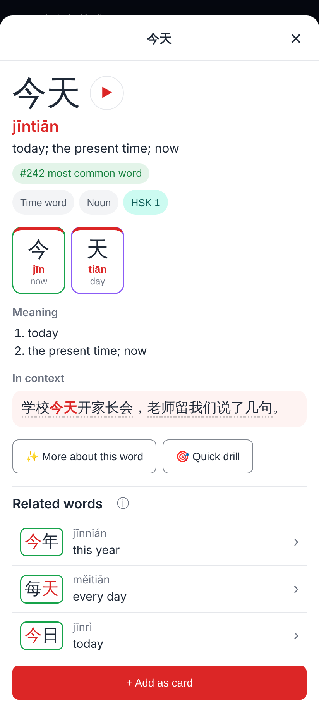
A word on the card → the language explorer (the video pauses): meaning, the sentence it was in, + Add as card / ⚡ Study it today.

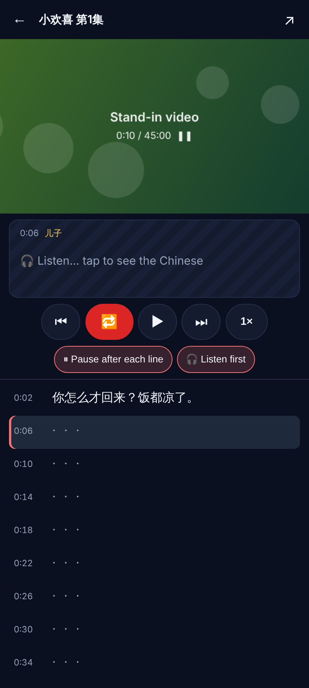
Listen first: the card and the lines from the current one on are covered; a tap uncovers the Chinese, then the pinyin, then the English.

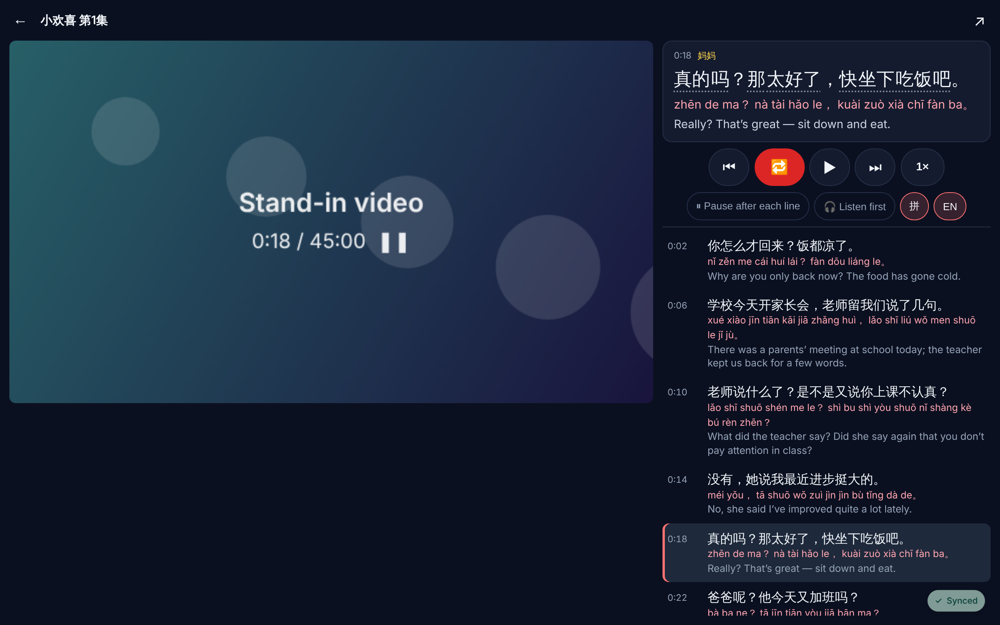
Unfolded / landscape: the video on the left, the card, controls and transcript on the right.

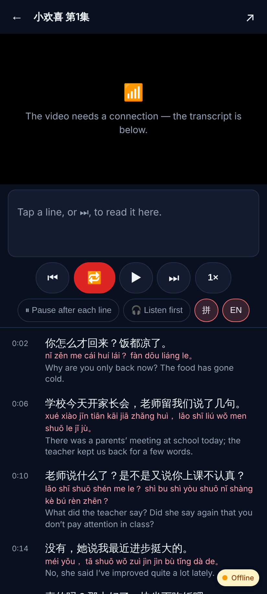
Offline: the video says it needs a connection; the transcript (kept on the device) is still readable.

## Lab app (Roborazzi; the WebView player is a placeholder box in screenshot tests)

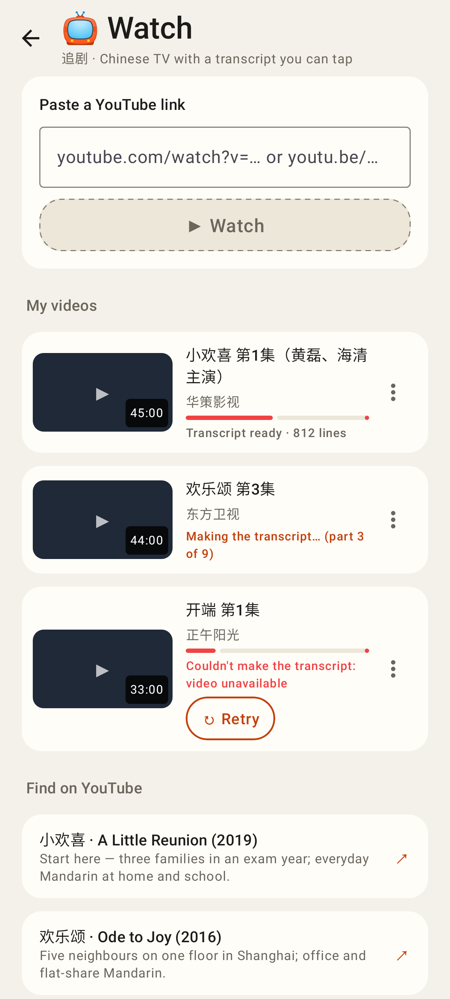
My videos, the paste box and Find on YouTube.

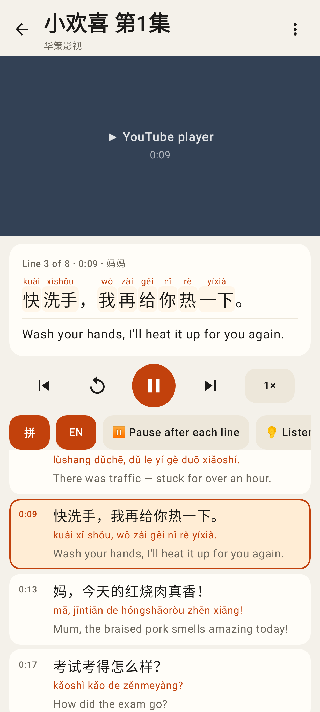
The player: the line card with word chips, ⏮ 🔁 ⏯ ⏭, speed, 拼 / EN / Pause after each line / Listen first, the transcript.

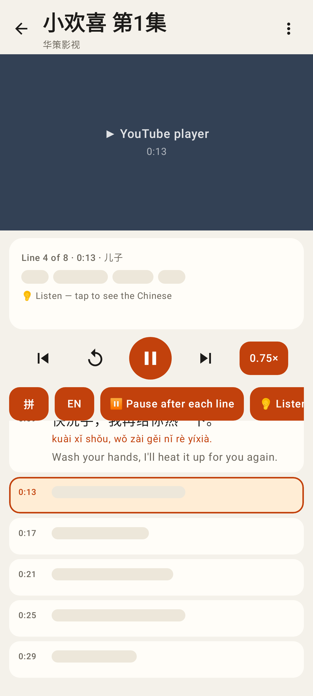
Listen first: the card covered until tapped.

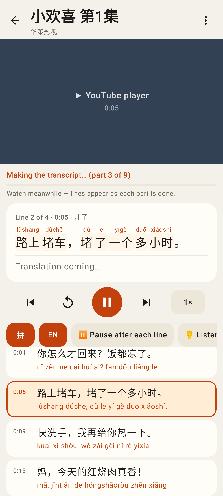
While the transcript is being made.

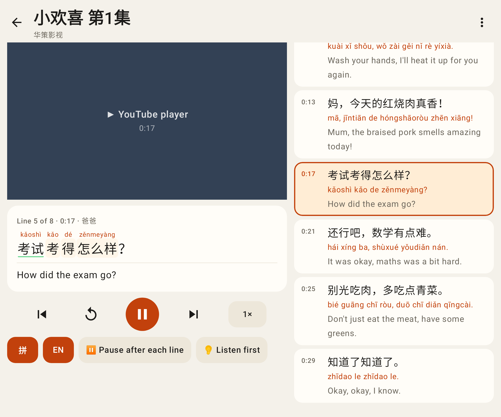
Unfolded: the video left, the rest right.
