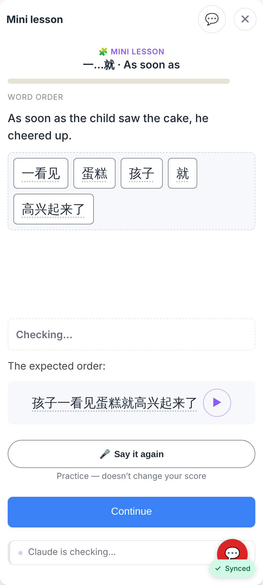
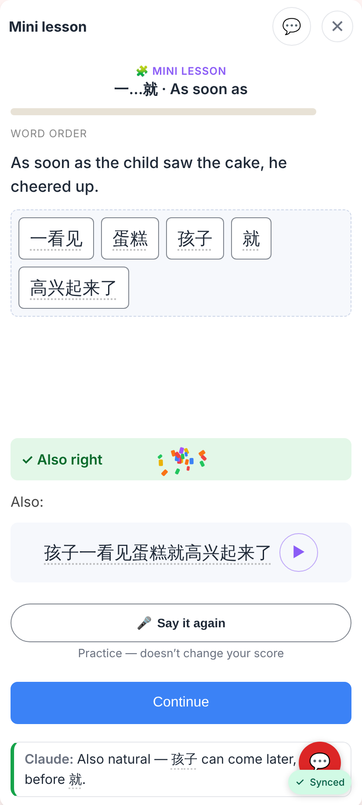
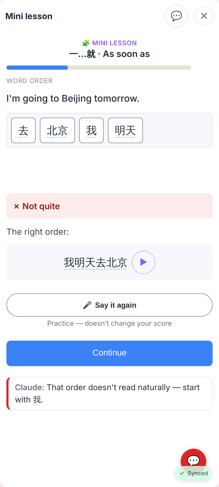

# Word order: an order the lesson didn't list, checked by Claude

Phone viewport (412×915, 2×), the mini-lesson player, E2E stand-in model (`e2e/tests/lesson-scramble-check.spec.ts`).

1. Jerome's 一看见蛋糕孩子就高兴起来了 (the lesson listed only 孩子一看见蛋糕就高兴起来了): "Checking…" in place of the verdict, the expected order shown at once, "Claude is checking…" below the buttons.

2. Claude says it is natural too: "✓ Also right" (scored right), the expected order as "Also:" with ▶, Claude's line below the buttons.

3. An order that doesn't work: "✗ Not quite", "The right order:", Claude's one-line reason. (Offline the strict "✗ Not quite" shows at once, with no line.)
