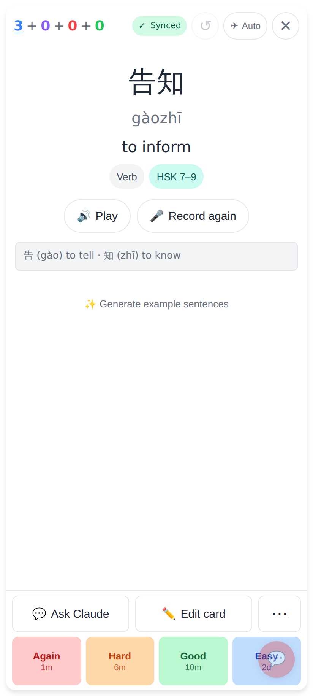
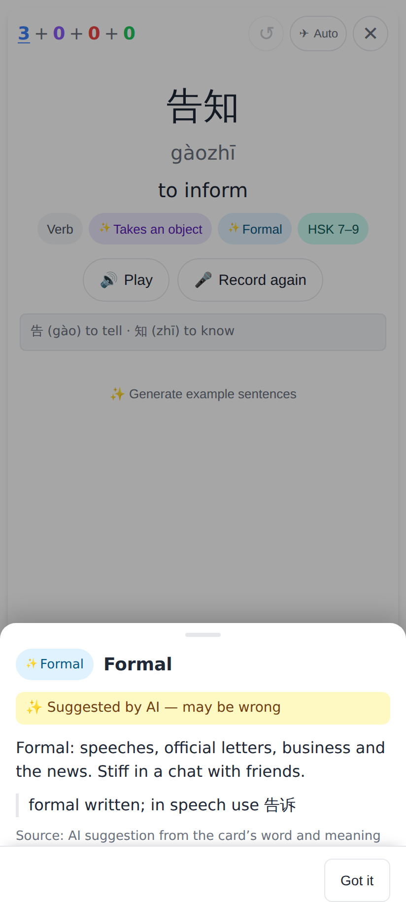
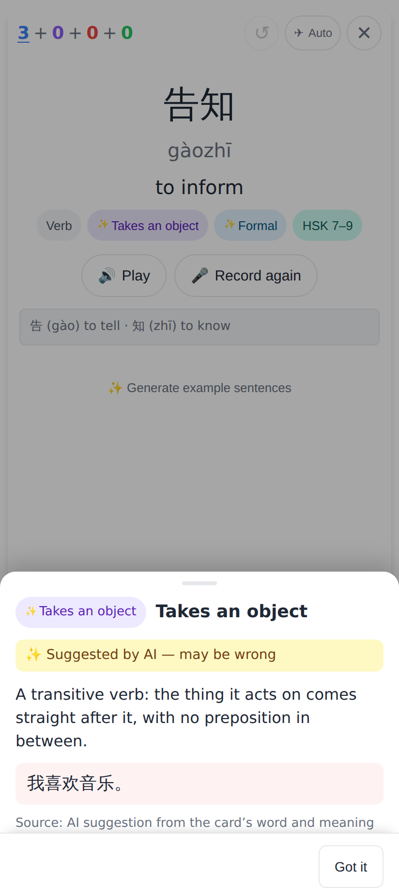
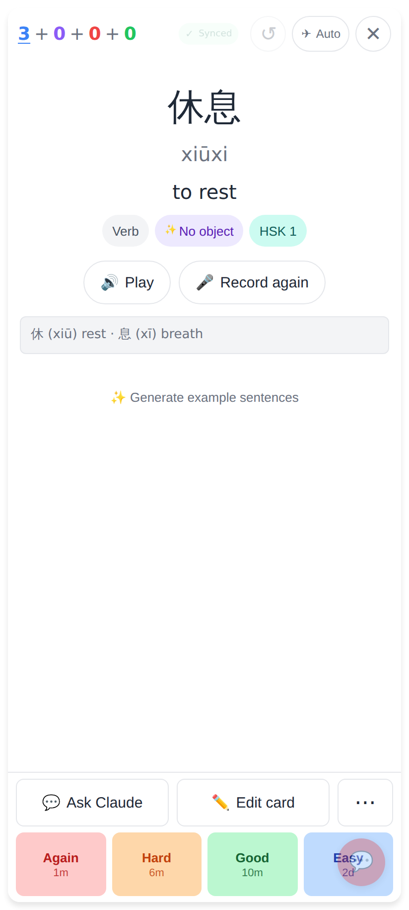
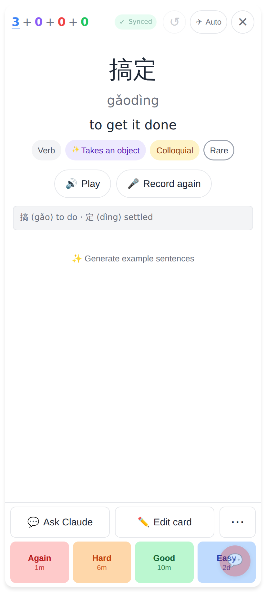
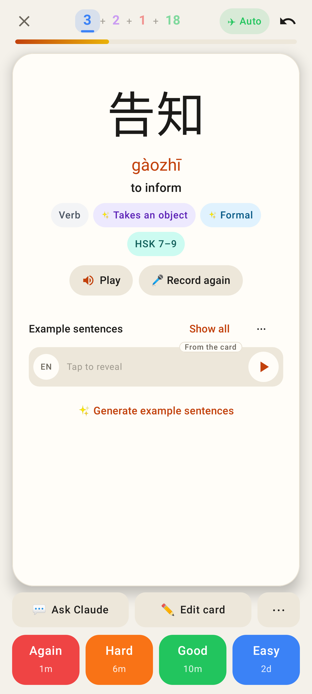
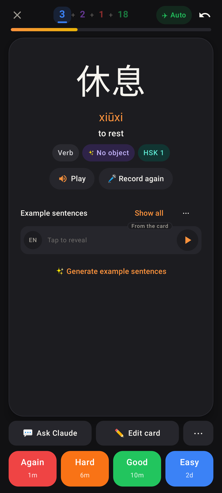
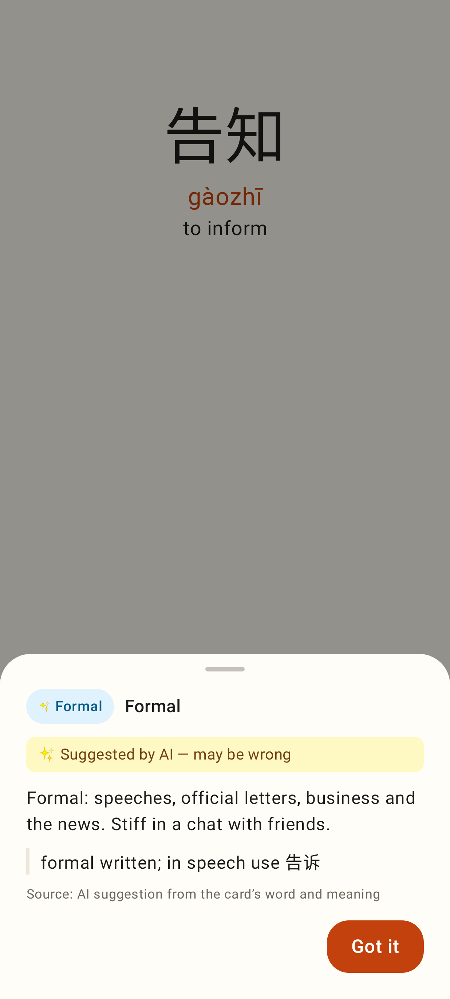
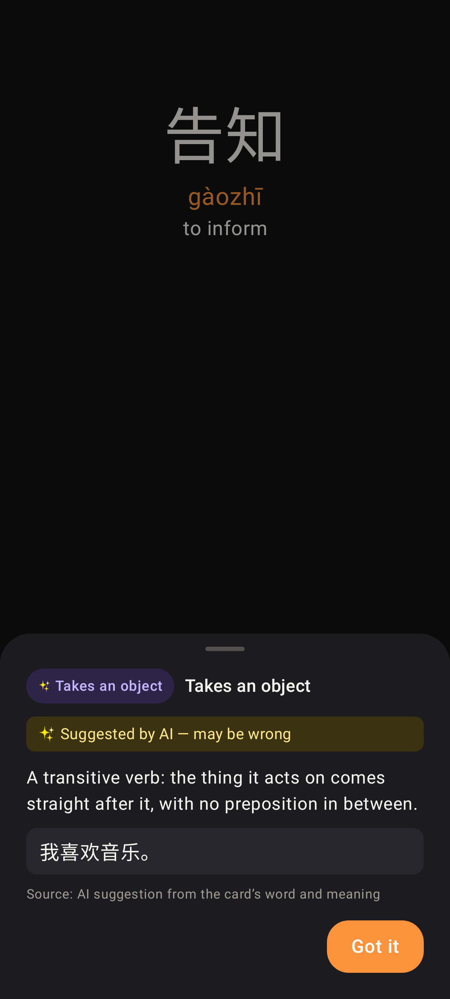

# AI word tags (✨) — screenshots

Phone viewport (web 412×915 @2×; Lab Roborazzi, Pixel Fold folded). Seeded with the E2E fake model.

## Web

Before: 告知 shows only what the lexicon knows (Verb · HSK 7–9).

After: ✨ Takes an object and ✨ Formal fill the gaps, after the part of speech.

Tapping ✨ Formal: "Suggested by AI — may be wrong" plus the register note.

Tapping ✨ Takes an object: what it means, with an example.

休息: ✨ No object.

搞定: the AI said "informal", but the lexicon already has Colloquial, so only the transitivity pill is added.

## Lab app

Lab: the same ✨ pills on the answer side.

Lab dark: 休息 with ✨ No object.

Lab: the register sheet with the AI notice and the note.

Lab dark: the transitivity sheet.
