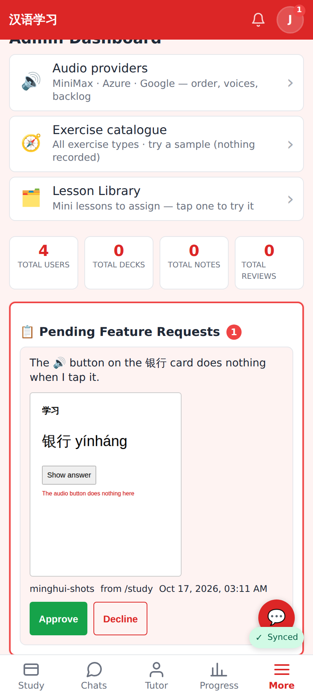

# Worker security fixes — screenshots

Admin dashboard (412×915 @2×): a pending feature request's screenshot still shows — it is now fetched with the admin's session into a blob URL, because `GET /api/feature-requests/screenshot/*` requires sign-in (the request's owner or an admin). The same URL without a session → 401, from another user → 404.
