# "You said" box redesign: screenshots

The study card's "You said" box on read cards, spoken answers, Say it practice and the homework pass, at phone width (412 × 915, 2×).

## Lab app (Compose, Roborazzi)

Before → after, every state on a minimal card back. From top to bottom: match, contains, didn't match, couldn't transcribe, transcribing.

| Before (light) | After (light) |
|---|---|
| 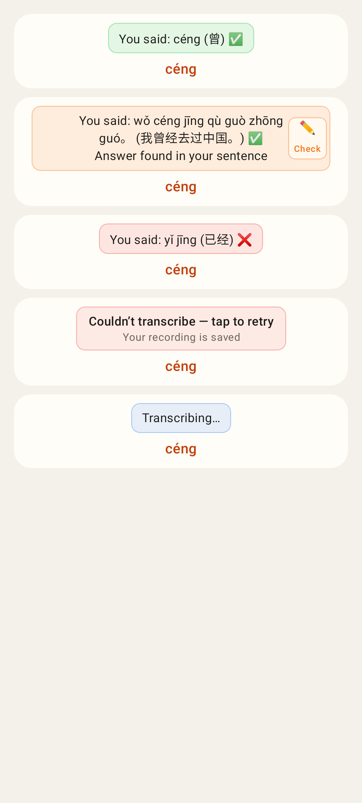 |  |

| Before (dark) | After (dark) |
|---|---|
| 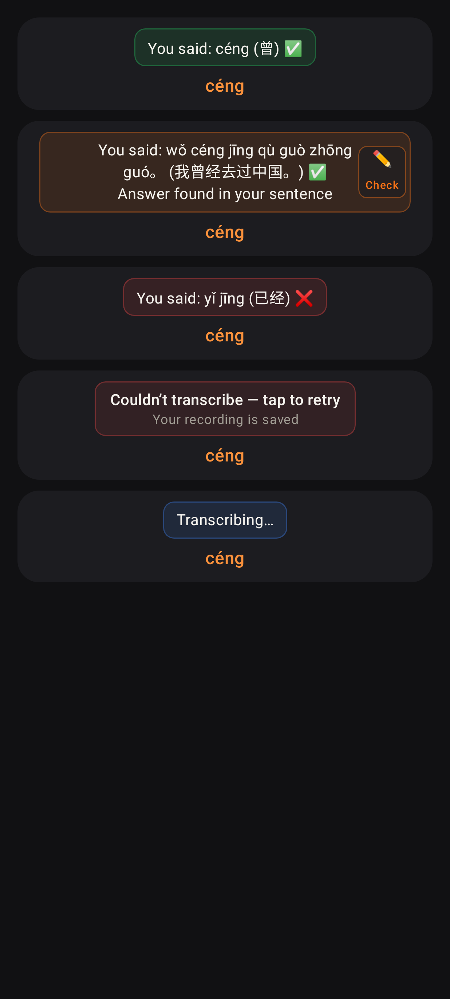 |  |

The whole study card, after:

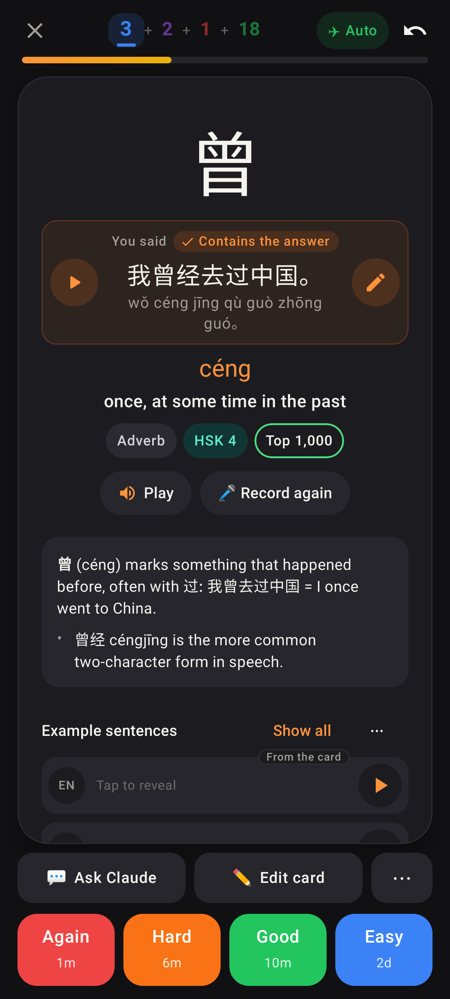
Contains the answer, dark (Jerome's case): ▶ on the left, the round ✎ Check in Coach on the right, and the text stays centred.

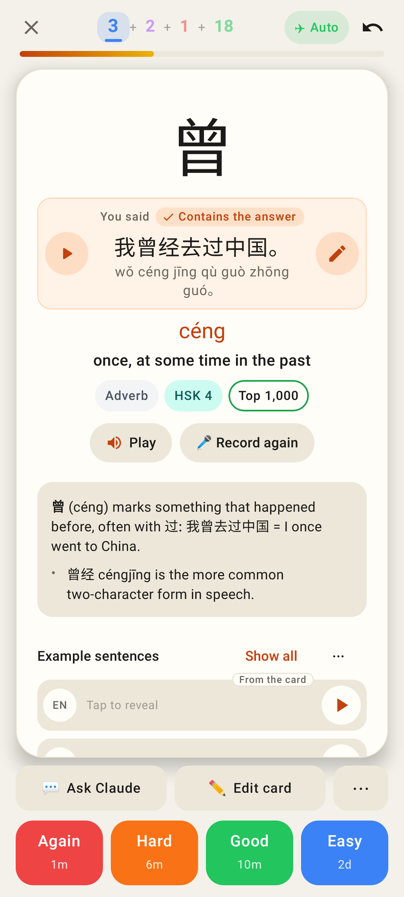
Contains the answer, light.

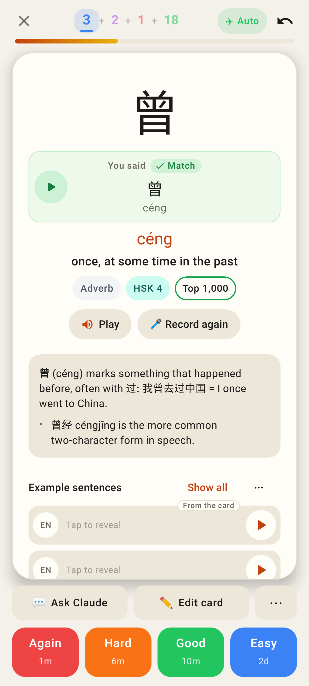
Match, light: no Coach button, but the right column stays empty so the text remains centred.

Match, dark.

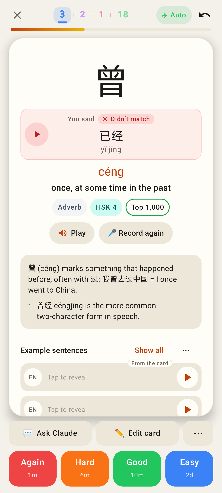
Didn't match, light.

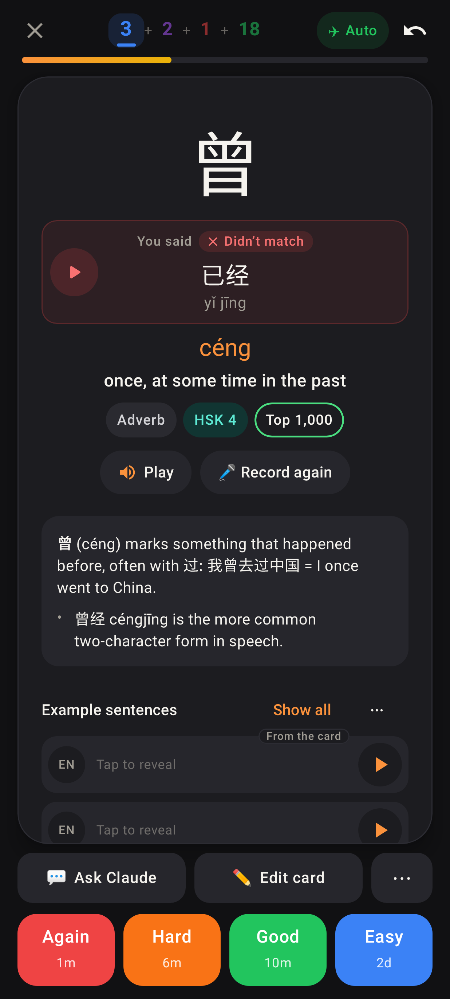
Didn't match, dark.

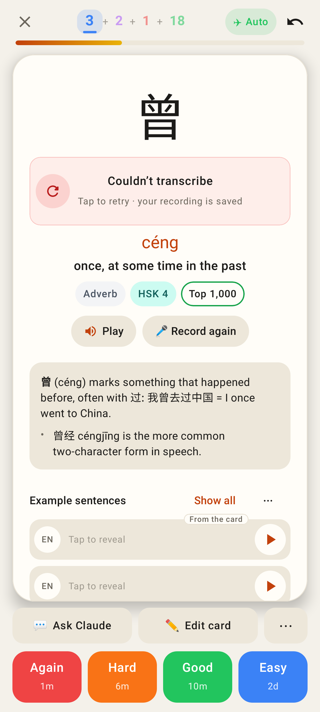
Couldn't transcribe, light. The whole box is the retry button.

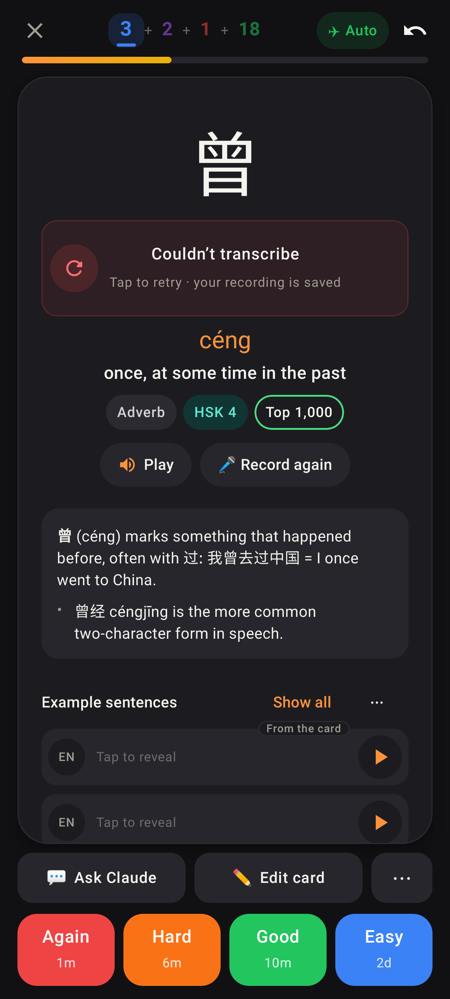
Couldn't transcribe, dark.

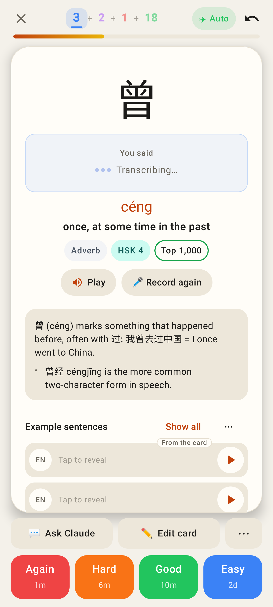
Transcribing…, light. Same shell and height as the result, so nothing jumps when the result arrives.

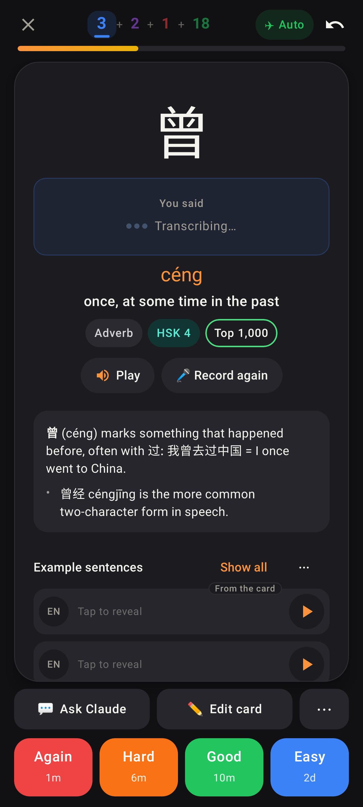
Transcribing…, dark.

## Web app (light; the web app has no dark theme)

All five states, cropped to the box:

| Before | After |
|---|---|
| 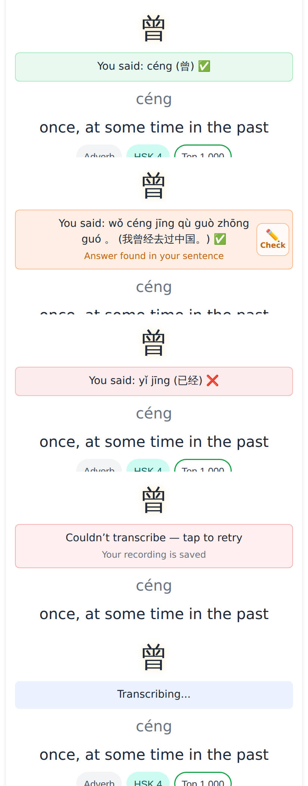 | 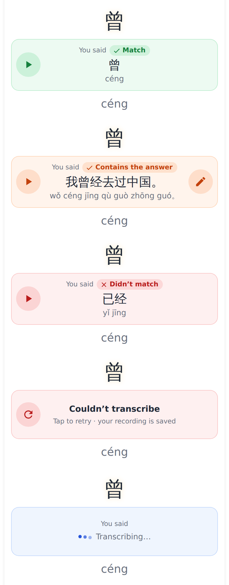 |

The full card:

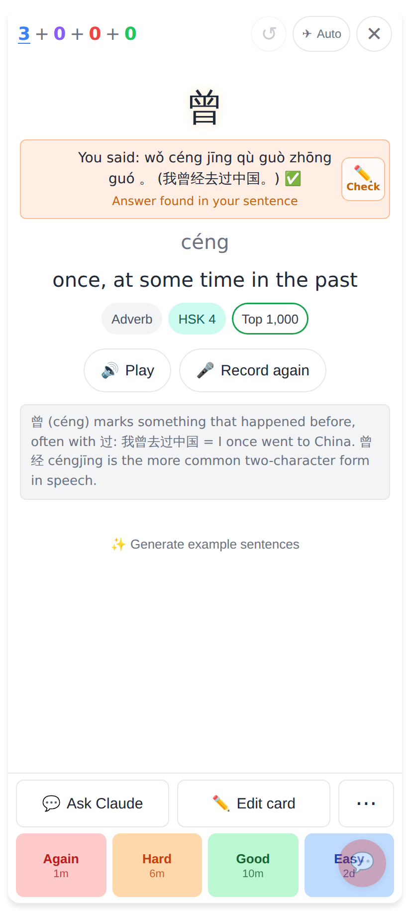
Before: "You said: pinyin (汉字) ✅", with a squarish ✏️ Check jammed into the right edge.

After: what was said is the hero, the verdict is a chip, and ▶ and ✎ are round 44px buttons.

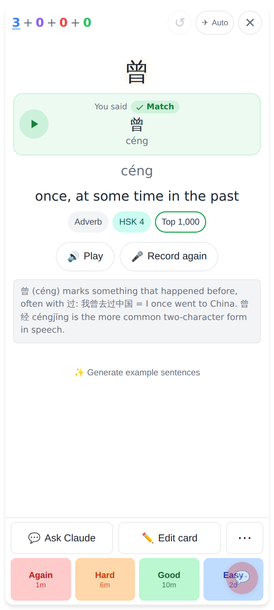
After, match.

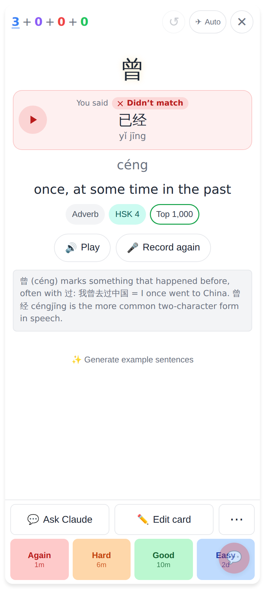
After, didn't match.

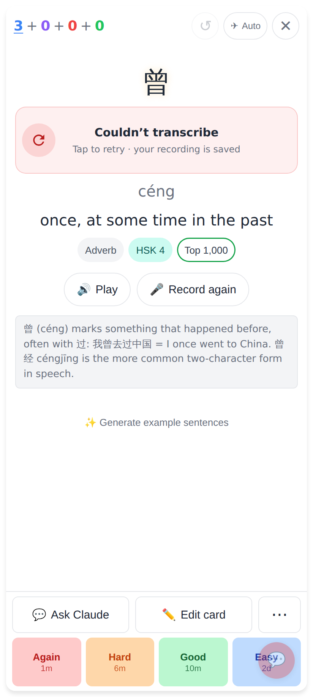
After, couldn't transcribe.

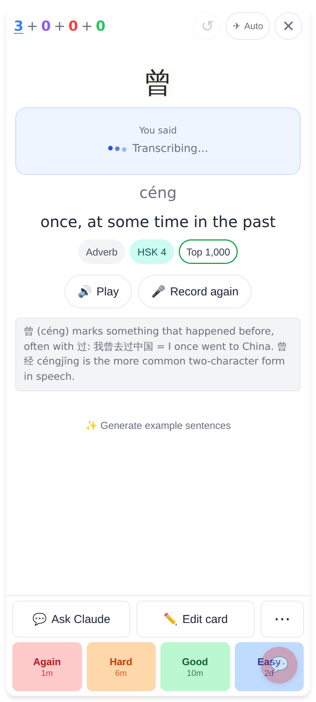
After, transcribing.
