# "You said": partly right is yellow — screenshots

Jerome said 一生救了他的命 for 救. The "✓ Contains the answer" chip was a dark orange / brown that he (red / green colour-blind) couldn't tell from the red "Didn't match". Now "partly right" is lemon YELLOW in both apps, and every verdict has its own icon and words: ✓ Match · ≈ Contains the answer · ✕ Didn't match. Phone width (412 × 915, 2×).

## Web (light; the web app has no dark theme yet — the dark token set is ready under `data-theme="dark"`)

| Before | After |
|---|---|
| 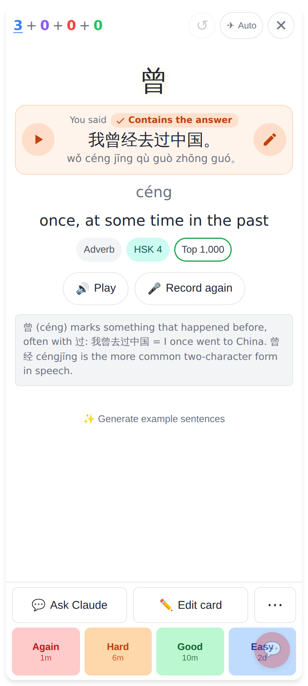 | 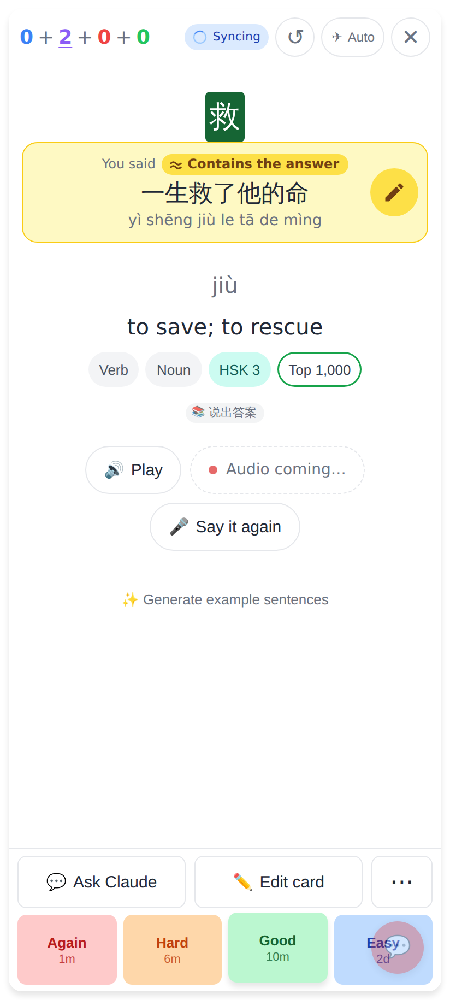 |

Before: the orange box. After: Jerome's own case on a typing card answered by speaking — the yellow box, a solid lemon chip "≈ Contains the answer" and a lemon ✎ circle, all with dark brown words / icons.

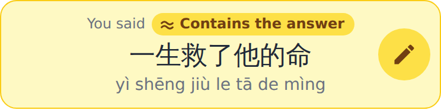
The box alone: lemon border + pale lemon tint; chip text #713f12 on #fde047 (6.9:1, AA).

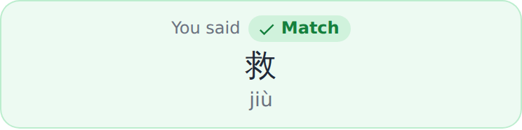
Match: unchanged green, ✓.

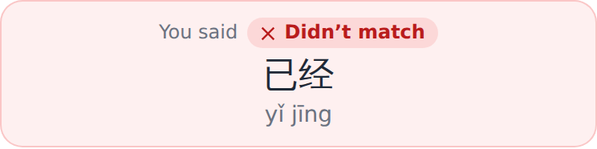
Didn't match: unchanged red, ✕.

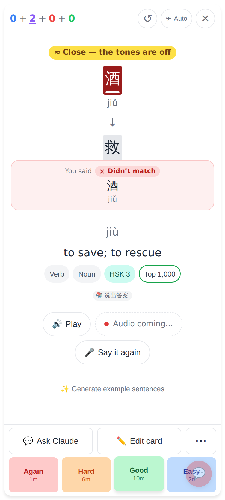
酒 (jiǔ) for 救 (jiù): "≈ Close — the tones are off" is now the same yellow, a lemon pill (it was orange text). The answer is still wrong, so the box under it stays red "✕ Didn't match".

## Lab app (Roborazzi)

| Before (light) | After (light) |
|---|---|
| 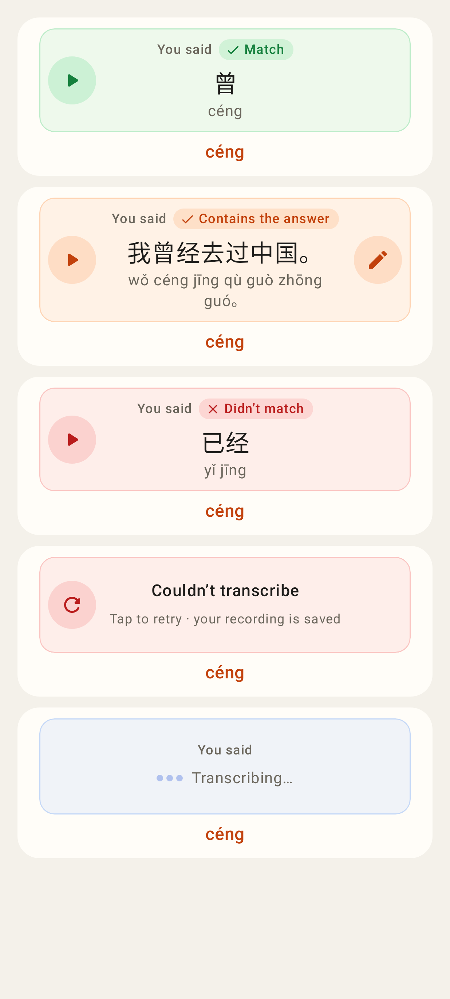 | 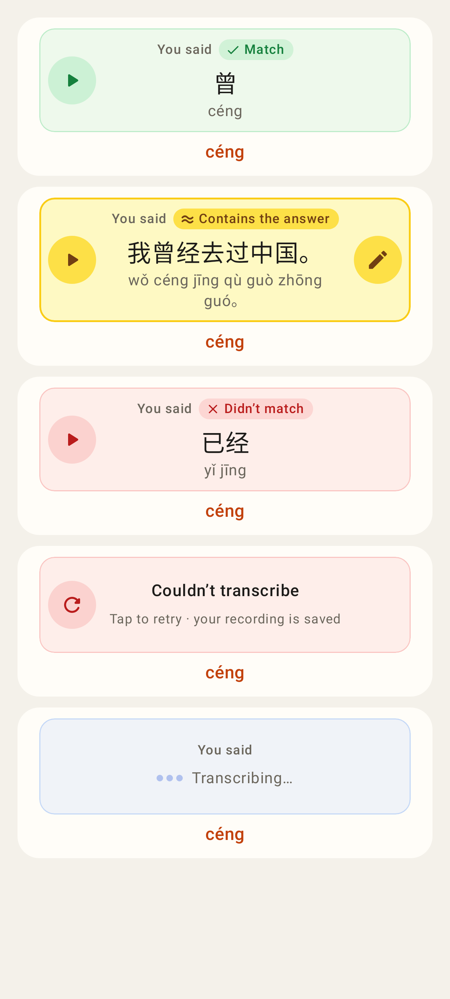 |

| Before (dark) | After (dark) |
|---|---|
| 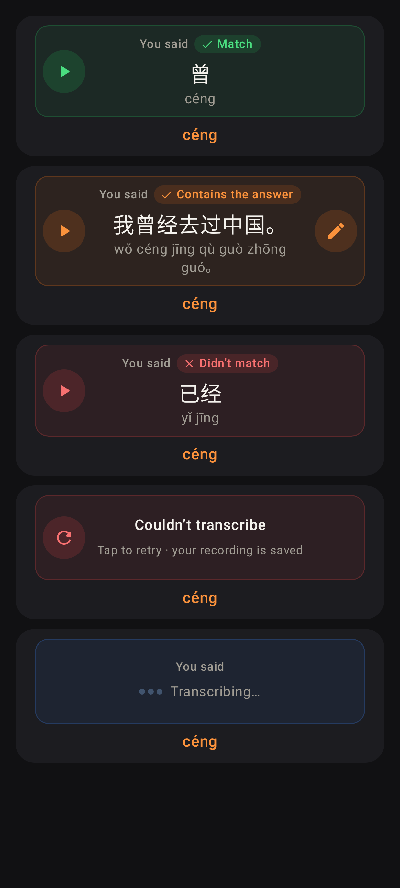 | 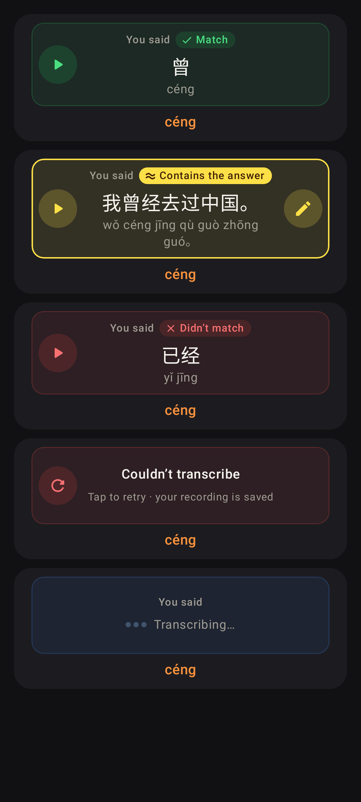 |

Every state of the box: match, contains (yellow), didn't match, couldn't transcribe, transcribing. In dark mode the border, icons and chip stay lemon; the chip keeps dark words (#422006 on #fde047).

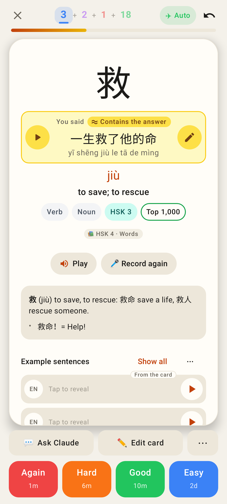
Jerome's case on the read card, light.

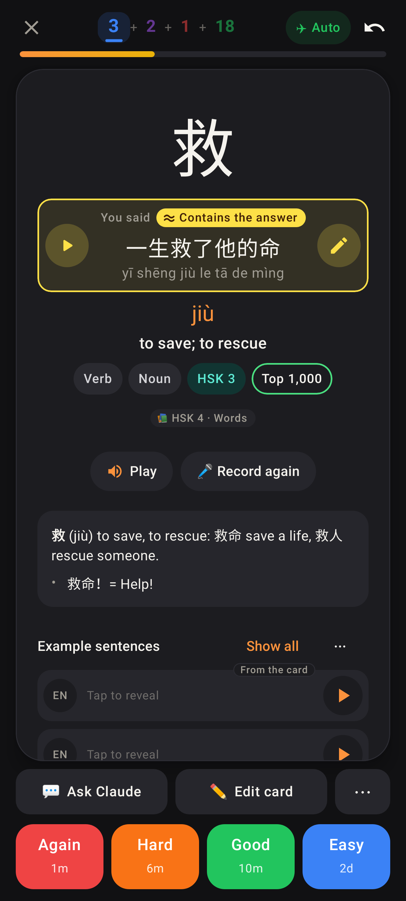
Jerome's case on the read card, dark.

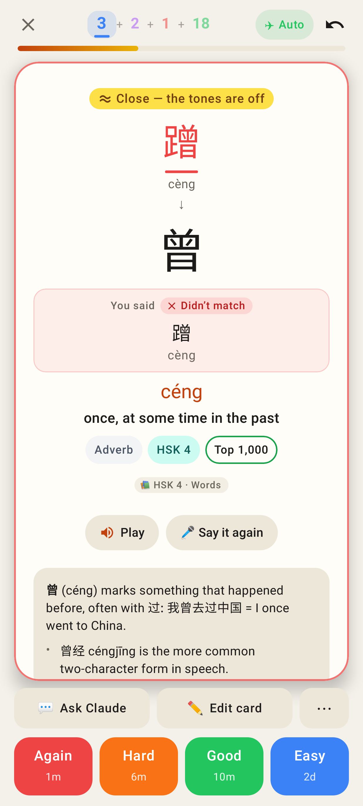
"≈ Close — the tones are off" on a typing card, light.

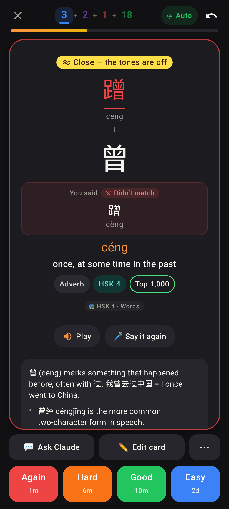
The same, dark.
